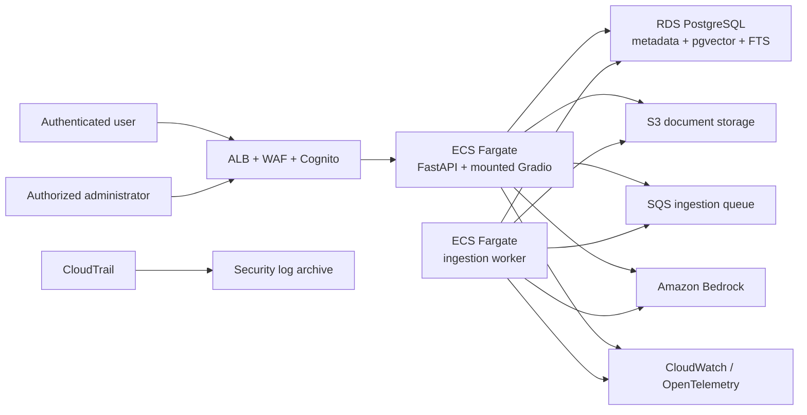
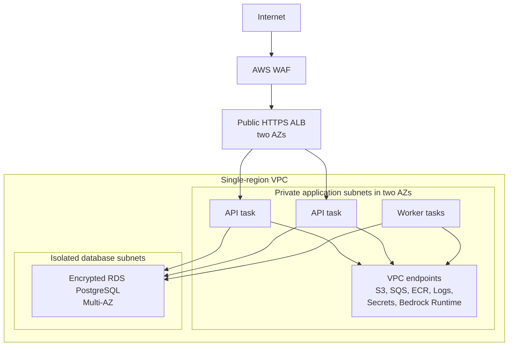
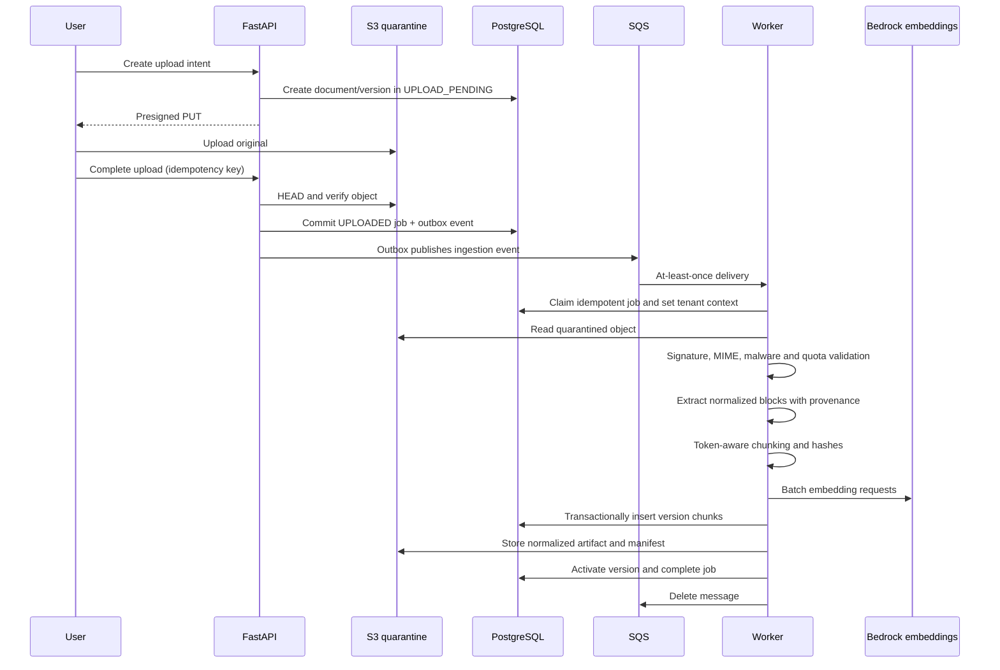
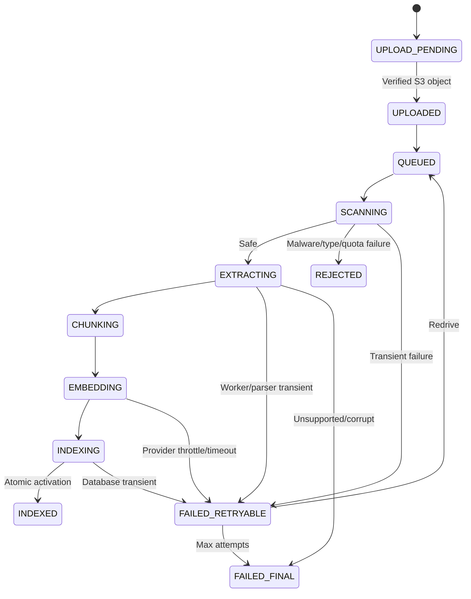
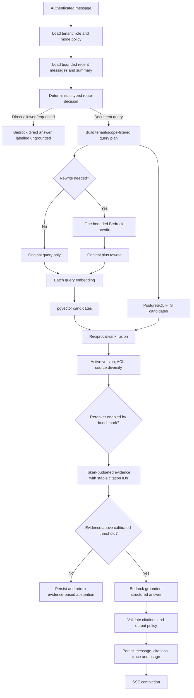

# AWS Pilot Production Blueprint

## 1. Target And Constraints

This blueprint is the recommended target for:

- A regulated multi-tenant pilot
- Up to 10 tenants
- Up to 100,000 source documents
- Fewer than 5 query requests per second
- Sensitive employee, contract, insurance, and customer content
- An evolutionary migration from the existing Python/Gradio application
- Low operational complexity rather than maximum theoretical scale

The target remains a **modular monolith**, not a microservice estate.

### Explicit MVP choices

| Concern | Decision |
|---|---|
| Application framework | FastAPI application with Gradio mounted at `/ui` as a transitional frontend |
| Compute | Two ECS Fargate task types: API/UI service and ingestion worker |
| Authentication | Amazon Cognito user pool; OIDC/JWT validation |
| Edge | HTTPS Application Load Balancer, ACM certificate, AWS WAF |
| Original/derived objects | Amazon S3 |
| Metadata, vectors, search, sessions | RDS PostgreSQL with `pgvector` and full-text search |
| Asynchronous work | Amazon SQS standard queue plus DLQ |
| Production LLM | Amazon Bedrock behind a model-gateway port |
| Embeddings | Amazon Titan Text Embeddings V2, 1,024 dimensions, versioned in configuration |
| Secrets | AWS Secrets Manager |
| Encryption | Customer-managed KMS keys for application data classes |
| Observability | CloudWatch plus OpenTelemetry traces |
| Infrastructure as code | Terraform |
| Dedicated vector DB | Not in MVP |
| Graph database | Not in MVP |
| Redis | Not in MVP |
| OpenSearch | Not in MVP |
| Arbitrary URL ingestion | Disabled until the isolated egress design is implemented |
| Public web search | Disabled by default; tenant-policy-gated later |

Titan V2's documented default output is 1,024 dimensions:
[Amazon Titan Text Embeddings](https://docs.aws.amazon.com/bedrock/latest/userguide/titan-embedding-models.html).

## 2. System Context



## 3. Deployment Topology



### Network rules

- Only the ALB has a public listener.
- API and worker tasks have no public IP.
- RDS accepts PostgreSQL only from API/worker security groups.
- S3, SQS, ECR, CloudWatch Logs, Secrets Manager, and Bedrock use VPC endpoints
  where regionally supported.
- Production tasks do not have unrestricted outbound internet access.
- External Groq, Mistral, LM Studio, DuckDuckGo, and arbitrary-URL traffic are
  disabled in production.
- A future URL-ingestion service must run as a separate egress-restricted worker
  with DNS/IP validation, proxy policy, and no route to private service ranges.

Bedrock can be reached through AWS PrivateLink without public IPs:
[Bedrock VPC endpoints](https://docs.aws.amazon.com/bedrock/latest/userguide/vpc-interface-endpoints.html).

### Availability choices

- Two API tasks spread across two Availability Zones.
- Worker desired count starts at one and can scale from queue backlog.
- RDS uses Multi-AZ and encrypted storage.
- SQS and S3 are regional managed services.
- One AWS region is used for the pilot. Select the region from data residency
  and approved Bedrock-model availability; do not use cross-region inference
  without governance approval.

## 4. Application Boundaries

Recommended Python package shape:

```text
src/knovera/
  api/              # FastAPI routes, auth dependencies, request/response mapping
  ui/               # Gradio composition and adapters
  application/      # Commands, queries, orchestration, policies
  domain/           # Typed entities, value objects, states, errors
  retrieval/        # Query planning, hybrid retrieval, fusion, context building
  ingestion/        # Validation, extraction, chunking, embedding stages
  ports/            # Protocols for storage, models, queues, extractors
  infrastructure/   # PostgreSQL, S3, SQS, Bedrock, telemetry adapters
```

Both FastAPI routes and Gradio callbacks call the same application services.
The mounted Gradio UI must not make HTTP calls back to its own process.

### Required ports

```python
class ObjectStore(Protocol): ...
class DocumentRepository(Protocol): ...
class ConversationRepository(Protocol): ...
class IngestionJobRepository(Protocol): ...
class RetrievalRepository(Protocol): ...
class JobQueue(Protocol): ...
class TextExtractor(Protocol): ...
class EmbeddingProvider(Protocol): ...
class ChatModelProvider(Protocol): ...
class AuditSink(Protocol): ...
```

Domain/application modules must not import `boto3`, SQLAlchemy, Gradio, or
provider SDKs directly.

## 5. Authentication, Tenancy, And Authorization

### Identity flow

1. User authenticates with Cognito or a federated enterprise identity provider.
2. Browser/API receives a signed OAuth access token.
3. ALB requires authentication for `/ui` and browser routes.
4. FastAPI also validates issuer, audience/client, signature, expiration, and
   token use before authorization.
5. Cognito `sub` maps to one or more `memberships`.
6. The request selects an allowed tenant, either from a tenant claim or an
   explicit header checked against memberships.
7. Application request context carries tenant ID, subject ID, roles, request ID,
   and policy.

Do not authorize from unsigned ALB headers alone. If ALB authentication headers
are used, verify their signature and expected load-balancer signer as documented
by AWS:
[ALB user authentication](https://docs.aws.amazon.com/elasticloadbalancing/latest/application/listener-authenticate-users.html).

### Roles

| Role | Capabilities |
|---|---|
| `viewer` | Query authorized knowledge, view permitted conversations/documents |
| `editor` | Viewer plus upload, reindex, and delete tenant documents |
| `tenant_admin` | Editor plus memberships, policies, retention, usage, tenant evaluations |
| `platform_admin` | System KB management and platform operations; no implicit tenant document read |
| `service_worker` | Internal ingestion operations only |

### Tenant enforcement

- Every tenant-owned row has non-null `tenant_id`.
- The API sets `SET LOCAL app.tenant_id = '<uuid>'` inside each transaction.
- PostgreSQL RLS is enabled and forced on every tenant table.
- The application role cannot use `BYPASSRLS` and is not a table owner.
- Background jobs derive tenant context from a signed/internal event and set the
  same database context.
- Shared built-in documents have `scope='system'` and null tenant ID; RLS
  permits only the explicit system scope plus the current tenant.
- Tests attempt cross-tenant reads with guessed IDs, filters, citations,
  conversation IDs, document IDs, and job IDs.

AWS recommends RLS for tenant isolation in a pooled PostgreSQL model:
[AWS pooled RLS guidance](https://docs.aws.amazon.com/prescriptive-guidance/latest/saas-multitenant-managed-postgresql/rls.html).

## 6. Public API Contract

Base path: `/api/v1`.

All write operations accept `Idempotency-Key`. All responses include
`X-Request-Id`. List endpoints use opaque cursor pagination.

### 6.1 Health

| Method/path | Auth | Purpose |
|---|---|---|
| `GET /health/live` | Internal/ALB | Process event loop is alive |
| `GET /health/ready` | Internal/ALB | Required config, database, and migration state are ready |

Readiness must not call an LLM or run a real vector query.

### 6.2 Upload and document routes

| Method/path | Role | Request / response |
|---|---|---|
| `POST /documents/uploads` | Editor | Validate metadata; create document/version/upload intent; return presigned S3 PUT and required headers |
| `POST /documents/{document_id}/versions/{version_id}/complete` | Editor | Verify S3 object attributes/hash; create job and enqueue ingestion |
| `GET /documents` | Viewer | Cursor list of authorized documents and latest status |
| `GET /documents/{document_id}` | Viewer | Document, versions, status, provenance summary |
| `DELETE /documents/{document_id}` | Editor | Mark deleting and enqueue idempotent deletion |
| `POST /documents/{document_id}/versions/{version_id}/reindex` | Editor | Create a new ingestion job using the existing immutable object |
| `GET /ingestion-jobs/{job_id}` | Viewer | Stage, progress, attempts, normalized error, timestamps |

Upload intent request:

```json
{
  "filename": "contract.pdf",
  "declared_content_type": "application/pdf",
  "size_bytes": 1200345,
  "sha256": "64-lowercase-hex-characters",
  "knowledge_scope": "tenant"
}
```

Upload intent response:

```json
{
  "document_id": "uuid",
  "version_id": "uuid",
  "upload": {
    "method": "PUT",
    "url": "short-lived-presigned-url",
    "required_headers": {
      "content-type": "application/pdf"
    },
    "expires_at": "ISO-8601"
  }
}
```

Presigned URLs expire after 15 minutes. Object keys are generated by the server,
never from raw filenames.

### 6.3 Conversation and answer routes

| Method/path | Role | Purpose |
|---|---|---|
| `POST /conversations` | Viewer | Create a conversation with selected mode/scope |
| `GET /conversations` | Viewer | List caller's authorized conversations |
| `GET /conversations/{conversation_id}/messages` | Viewer | Paginated persisted history and citations |
| `POST /conversations/{conversation_id}/messages` | Viewer | Route/retrieve/generate answer; supports SSE |
| `DELETE /conversations/{conversation_id}` | Viewer/owner | Start deletion under tenant retention policy |

Conversation creation request:

```json
{
  "mode": "system_kb | tenant_kb | direct",
  "document_filter": {
    "document_ids": []
  }
}
```

Message request:

```json
{
  "content": "What renewal notice is required?",
  "response_mode": "stream",
  "retrieval_options": {
    "allow_rewrite": true
  }
}
```

The user cannot enable web access, bypass tenant filters, choose arbitrary model
IDs, or increase token limits through this request.

SSE event types:

```text
message.accepted
retrieval.completed
answer.delta
answer.citation
answer.completed
error
```

`retrieval.completed` exposes counts/timing and safe source labels, not hidden
documents or raw scores that reveal unauthorized content.

### 6.4 Administration

| Method/path | Role | Purpose |
|---|---|---|
| `POST /admin/evaluation-runs` | Tenant/platform admin | Start an asynchronous versioned evaluation |
| `GET /admin/evaluation-runs/{run_id}` | Tenant/platform admin | Status and aggregate/results |
| `GET /admin/audit-events` | Tenant/platform admin | Authorized, filtered audit access |
| `GET /admin/usage` | Tenant admin | Tenant storage, vector, job, and model usage |

The existing full-suite buttons become clients of these admin routes or are
removed from the production UI.

### 6.5 Error envelope

```json
{
  "error": {
    "code": "DOCUMENT_NOT_READY",
    "message": "The document is still being indexed.",
    "request_id": "uuid",
    "retryable": true,
    "details": {}
  }
}
```

Rules:

- Stable machine-readable codes.
- User-safe messages.
- No provider exception, SQL, path, key, prompt, stack trace, or hidden source
  content.
- Field validation errors can include safe field names/reasons.

## 7. Database Schema

Use UUID primary keys generated by the application or PostgreSQL. Use
`timestamptz` in UTC. Every mutable table has `created_at`, `updated_at`, and a
version column where optimistic concurrency matters.

### 7.1 Identity and policy

#### `tenants`

| Column | Notes |
|---|---|
| `id` | UUID primary key |
| `name` | Display name |
| `status` | `active`, `suspended`, `deleting`, `deleted` |
| `policy` | Validated JSONB for direct/web/model/retention/quota settings |
| `kms_key_arn` | Optional tenant-specific key; platform key for pilot default |

#### `memberships`

| Column | Notes |
|---|---|
| `tenant_id` | FK and RLS key |
| `subject_id` | Cognito `sub` |
| `role` | Enum from the role table above |
| `status` | Active/revoked |

Unique: `(tenant_id, subject_id)`.

### 7.2 Documents and versions

#### `documents`

| Column | Notes |
|---|---|
| `id` | UUID |
| `tenant_id` | Nullable only for system scope |
| `scope` | `system` or `tenant` |
| `display_name` | Sanitized user-facing name |
| `status` | `active`, `deleting`, `deleted` |
| `current_version_id` | FK switched only after successful indexing |
| `created_by` | Subject ID |

#### `document_versions`

| Column | Notes |
|---|---|
| `id` | UUID |
| `document_id`, `tenant_id` | Ownership and RLS |
| `version_number` | Monotonic per document |
| `status` | Upload/ingestion state machine |
| `s3_bucket`, `s3_key`, `s3_version_id` | Immutable original reference |
| `original_filename` | Display only |
| `declared_mime`, `detected_mime` | Validation evidence |
| `size_bytes`, `sha256` | Integrity and quota |
| `classification` | Data classification |
| `parser_name`, `parser_version` | Extraction lineage |
| `embedding_model`, `embedding_dimension` | Vector lineage |
| `normalized_s3_key` | Versioned extracted block artifact |
| `failure_code` | Normalized final failure |

Unique: `(tenant_id, document_id, version_number)` and
`(tenant_id, sha256, document_id)` as the chosen duplicate/version policy.

### 7.3 Chunks and search

#### `document_chunks`

| Column | Notes |
|---|---|
| `id` | UUID, stable for one version/chunk |
| `tenant_id`, `scope` | RLS/system visibility |
| `document_id`, `document_version_id` | Provenance |
| `ordinal` | Stable source order |
| `parent_section_id` | Optional parent block/chunk |
| `page_start`, `page_end` | Nullable page provenance |
| `heading_path` | JSONB ordered headings |
| `content` | Normalized chunk text |
| `token_count` | Embedding-tokenizer count |
| `content_sha256` | Incremental identity |
| `search_vector` | Generated/configured `tsvector` |
| `embedding` | `vector(1024)` |
| `embedding_model` | Exact model/profile version |
| `metadata` | Bounded format-specific JSONB |

Indexes:

- B-tree `(tenant_id, document_version_id, ordinal)`
- B-tree `(tenant_id, document_id)`
- Unique `(document_version_id, content_sha256, ordinal)`
- GIN on `search_vector`
- HNSW on `embedding vector_cosine_ops`

All retrieval SQL includes scope/tenant and active document-version predicates.
Benchmark filtered HNSW recall before production release.

### 7.4 Jobs and events

#### `ingestion_jobs`

| Column | Notes |
|---|---|
| `id` | UUID |
| `tenant_id`, `document_version_id` | Ownership |
| `status` | State machine |
| `stage` | Current stage |
| `attempt_count` | Durable count |
| `idempotency_key` | Unique per requested operation |
| `progress` | Validated JSONB counts, no document text |
| `failure_code`, `failure_summary` | Safe diagnostics |
| `started_at`, `completed_at`, `lease_expires_at` | Operations |

#### `outbox_events`

Used to publish SQS work reliably after committing document/job state:

- Event ID/version/type
- Tenant and aggregate IDs
- JSON payload without raw document content
- Created/published timestamps
- Attempt count

An outbox publisher sends unpublished events and marks them published. SQS
delivery remains at-least-once; workers remain idempotent.

### 7.5 Conversations and citations

#### `conversations`

- ID, tenant, owner subject, mode, status
- Bounded summary and summary token count
- Retrieval policy snapshot
- Last activity and expiry

#### `messages`

- ID, tenant, conversation, role, content
- Sequence number and token count
- Model/prompt/retrieval trace IDs for assistant messages
- Safety status and timestamps

#### `message_citations`

- Message ID, citation label
- Document/version/chunk IDs
- Quoted span or safe excerpt
- Retrieval/rerank scores in restricted diagnostic columns

#### `retrieval_traces`

- Query hash and optional encrypted query reference
- Query-plan/rewrite version
- Candidate/final IDs and scores
- Timings and abstention reason
- Embedding/index/model versions

Raw sensitive context should not be duplicated into ordinary logs.

### 7.6 Audit

`audit_events` is append-only at the application permission level:

- Tenant, subject, request/correlation IDs
- Action, resource type/ID, outcome
- Source IP/user agent where permitted
- Safe metadata
- Timestamp

Audit events include authentication decisions, document access, upload,
ingestion, deletion, policy change, role change, evaluation, export, and admin
actions.

## 8. S3 Design

### 8.1 Buckets/prefixes

Use separate data classes, either separate buckets or strongly separated
prefixes:

```text
knovera-<env>-quarantine/
  tenants/<tenant_id>/uploads/<version_id>/original

knovera-<env>-documents/
  system/documents/<document_id>/versions/<version_id>/...
  tenants/<tenant_id>/documents/<document_id>/versions/<version_id>/...

knovera-<env>-audit/
  AWSLogs/...
  application-audit-exports/...
```

Quarantine objects are not readable by the answer API. Only the scanner/worker
role can read them.

### 8.2 Controls

- Block Public Access at account and bucket level.
- Bucket-owner-enforced object ownership; no ACL use.
- SSE-KMS with environment data-class keys.
- TLS-only bucket policies.
- Versioning on document and audit buckets.
- Lifecycle incomplete uploads and quarantine failures quickly.
- Lifecycle old noncurrent versions according to tenant retention.
- Log data events for sensitive operations according to cost/policy.
- Presigned PUT constrained by generated key, content type, size policy, and
  short expiry.
- Store original filename only as metadata after sanitization; never use it as a
  path segment.

Do not enable S3 Object Lock on ordinary tenant documents by default. Use a
separate archive bucket when a legal WORM requirement exists, because locked
versions cannot satisfy normal deletion semantics until retention expires.

## 9. Ingestion Pipeline



### 9.1 Job state machine



### 9.2 Worker rules

- Process SQS standard messages as at-least-once.
- Claim job/version with compare-and-set status.
- No-op if the exact version is already indexed.
- Extend visibility timeout while processing.
- Commit chunks and active-version switch atomically.
- Delete old active chunks only after new version activation and retention
  decision.
- Do not put document text in SQS.
- Use bounded batches, parser subprocess timeouts, memory/CPU task limits, and
  temporary encrypted ephemeral storage.
- Send final failures to the DLQ and alarm on any DLQ message.

### 9.3 Ingestion event

```json
{
  "event_type": "DocumentIngestionRequested",
  "event_version": 1,
  "event_id": "uuid",
  "tenant_id": "uuid",
  "document_id": "uuid",
  "document_version_id": "uuid",
  "ingestion_job_id": "uuid",
  "object": {
    "bucket": "quarantine-bucket",
    "key": "generated-key",
    "version_id": "s3-version",
    "sha256": "hex",
    "size_bytes": 1200345,
    "declared_mime": "application/pdf"
  },
  "parser_profile": "default-v1",
  "embedding_profile": "titan-v2-1024-v1",
  "correlation_id": "uuid",
  "created_at": "ISO-8601"
}
```

## 10. Retrieval And Answer Pipeline



### 10.1 Mode policy

| Mode | Search scope | Fallback |
|---|---|---|
| `system_kb` | Active system documents only | Abstain |
| `tenant_kb` | Current tenant active documents only | Abstain unless user explicitly switches to direct mode and policy allows it |
| `direct` | No retrieval | Clearly label as general model answer |

Web search is not inferred from words like `latest`. It is a separate
tenant-governed capability and route when implemented.

### 10.2 Initial retrieval defaults

These are starting values, not permanent truths:

| Setting | Initial value |
|---|---:|
| Vector candidates | 30 |
| Full-text candidates | 30 |
| RRF constant | 60 |
| Fused candidates before diversity/rerank | 30 |
| Final context chunks | Up to 8 |
| Duplicate parent/source cap | 2 chunks per parent section unless analytical plan expands it |
| Query rewrites | Maximum 1 |
| Answer model calls | Maximum 1 after optional rewrite |

Tune only through the versioned evaluation suite. Preserve score distributions
to calibrate abstention rather than copying the current `1.6` threshold.

### 10.3 Structured answer contract

Internal model output:

```json
{
  "answer": "string",
  "citations": [
    {
      "citation_id": "C1"
    }
  ],
  "abstention": null
}
```

or:

```json
{
  "answer": "",
  "citations": [],
  "abstention": {
    "code": "INSUFFICIENT_EVIDENCE",
    "message": "The authorized documents do not contain enough evidence."
  }
}
```

The application validates citation IDs against the supplied evidence map before
persisting or streaming completion.

## 11. Model Gateway

### Interface responsibilities

- Map stable application tasks to approved model profiles.
- Apply per-task timeouts, retry policy, maximum input/output tokens, and
  temperature.
- Record model ID/version, region, latency, tokens, cost estimate, and request
  outcome.
- Enforce tenant data classification and provider policy.
- Convert provider-specific failures into normalized errors.
- Redact secrets from diagnostics.
- Support request cancellation when clients disconnect.

### Production profiles

| Profile | Purpose |
|---|---|
| `rewrite-v1` | Short rewrite/condensation with small output cap |
| `answer-grounded-v1` | Final evidence-grounded answer |
| `answer-direct-v1` | Explicit direct mode |
| `embedding-titan-v2-1024-v1` | Titan Text Embeddings V2 at 1,024 dimensions |

The final answer model is selected from an approved Bedrock allowlist through
quality, latency, regional availability, and cost evaluation. It is configured
by immutable deployment profile, not exposed as an unrestricted user dropdown.

Bedrock traffic uses its native Converse/runtime API through PrivateLink. The
provider port keeps local/OpenAI-compatible adapters usable in development and
tests.

## 12. Configuration And Secrets

Use a validated Pydantic settings model with:

- Environment name and AWS region
- Database host/name/SSL requirements
- S3 bucket names
- SQS/DLQ URLs
- Cognito issuer, audience, and allowed algorithms
- Bedrock task profile model IDs
- Embedding model/dimension/index version
- Upload, extraction, token, document, tenant, and rate quotas
- Timeout/retry/circuit-breaker values
- Feature flags for direct/web/evaluation routes
- Prompt/retrieval configuration versions

Rules:

- Non-secret config comes from environment/task definition.
- Secrets come from Secrets Manager and ECS secret injection or runtime fetch.
- `.env` is development-only and must not override deployed environment values.
- Startup validates all required fields and database migration compatibility.
- No API keys, bucket URIs, model IDs, or tenant policies are hardcoded in
  source.

## 13. Encryption, Retention, And Deletion

### Encryption

- ACM/TLS at ALB.
- TLS from tasks to RDS with certificate validation.
- RDS encrypted with a customer-managed KMS key. RDS encryption covers storage,
  logs, backups, and snapshots:
  [RDS encryption](https://docs.aws.amazon.com/AmazonRDS/latest/UserGuide/Overview.Encryption.html).
- S3 and SQS use KMS.
- Secrets Manager uses KMS and rotation where supported.
- Bedrock through private endpoints and IAM.

### Retention

Tenant policy defines:

- Original/derived document retention
- Conversation retention
- Failed quarantine retention
- Audit retention
- Noncurrent version retention
- Evaluation artifact retention

Defaults for pilot:

| Data | Default |
|---|---|
| Failed/incomplete quarantine | 7 days |
| Replaced document versions | 30 days unless tenant policy requires less/more |
| Conversations | 30 days |
| Ingestion job details | 90 days |
| Application audit | 1 year |
| DLQ messages | 14 days with controlled redrive |

Legal/compliance owners must approve final periods.

### Deletion workflow

1. Authorize request and write audit event.
2. Mark document/conversation `deleting`; hide it from retrieval immediately.
3. Enqueue idempotent deletion job.
4. Delete active/noncurrent chunks and citations.
5. Delete or expire S3 versions according to legal-hold/retention constraints.
6. Clear caches and derived normalized artifacts.
7. Mark `deleted` with completion/evidence; retain only policy-approved
   tombstone/audit fields.
8. Alarm and expose status if any storage class cannot complete deletion.

Never promise immediate physical deletion from immutable backups. Document
backup-expiry semantics accurately.

## 14. Observability

### Logging

Structured JSON only. Required common fields:

```text
timestamp, level, service, environment, request_id, correlation_id,
tenant_id, subject_id, operation, resource_type, resource_id,
duration_ms, outcome, error_code
```

Do not log raw documents, full prompts, histories, presigned URLs, tokens,
provider keys, embeddings, or model outputs by default.

### Tracing

OpenTelemetry spans:

- HTTP request and auth
- Database transaction/query
- Route decision
- Query rewrite
- Embedding call
- Vector search
- Full-text search
- Fusion/rerank
- Context build
- Model invocation
- S3/SQS operations
- Every ingestion stage

### Alarms

| Signal | Initial alarm |
|---|---|
| API 5xx | More than 2 percent for 5 minutes |
| API p95 | Above 8 seconds for non-stream completion window |
| First answer event p95 | Above 3 seconds |
| Bedrock errors/throttles | Above 2 percent or sustained throttling |
| Retrieval no-hit | Sudden 2x baseline per tenant/index version |
| SQS oldest message | Above 10 minutes |
| DLQ depth | Any message |
| Ingestion failure | Above 5 percent per 15 minutes |
| RDS storage | Less than 20 percent free |
| RDS connections/CPU | Above planned safe threshold for 15 minutes |
| Deletion backlog | Any job beyond policy deadline |

## 15. SLOs, Recovery, And Capacity

### Pilot service objectives

| Objective | Target |
|---|---|
| Authenticated API availability | 99.9 percent monthly |
| Query first-event p95 | <= 3 seconds |
| Query complete p95 | <= 8 seconds for normal lookup |
| Ingestion completion | 95 percent of supported <=10 MB files within 5 minutes |
| Cross-tenant retrieval | Zero tolerated |
| Citation validity | 100 percent cited IDs resolve to authorized supplied evidence |
| RPO | <= 15 minutes |
| RTO | <= 2 hours |

Model-provider time is included in user latency but tracked separately.

### Initial quotas

| Resource | Pilot default |
|---|---:|
| File size | 10 MiB |
| Files per batch | 20 |
| Extracted text | 5 million characters per file |
| PDF pages | 500 |
| Image pixels | 40 megapixels |
| Chunks per document version | 20,000 |
| Tenant source storage | 10 GiB |
| Tenant indexed documents | 10,000 |
| Concurrent ingestion jobs per tenant | 2 |
| Query rate | 1 request/second sustained, burst 5 per tenant |

These limits are enforced server-side and can be changed by validated tenant
plans, not UI text.

### Backup and restore

- RDS automated backups with point-in-time recovery and an approved retention
  period.
- Periodic manual/AWS Backup snapshots according to recovery policy.
- S3 versioning and lifecycle.
- Terraform state stored in a protected versioned backend.
- Quarterly restore test into an isolated environment.
- Restore verification includes RLS, vector extension/index, active document
  versions, and representative retrieval.

RDS supports automated backups and point-in-time recovery within the configured
retention window:
[RDS automated backups](https://docs.aws.amazon.com/AmazonRDS/latest/UserGuide/USER_WorkingWithAutomatedBackups.html).

## 16. CI/CD And Environments

Environments:

- `dev`: local/mocked services permitted; synthetic data only
- `staging`: production topology with synthetic/redacted test corpus
- `prod`: approved region, real identities and tenant data

Pipeline:

1. Format, lint, type-check, unit tests.
2. Dependency/license/secret scan and SBOM.
3. Build pinned non-root container image.
4. Image vulnerability scan; sign image.
5. Integration tests with PostgreSQL/pgvector and AWS test resources.
6. RAG and security evaluation gates.
7. Terraform plan and policy checks.
8. Deploy database-compatible application to staging.
9. Smoke/isolation tests.
10. Manual production approval.
11. ECS rolling/canary deployment with automatic rollback on health/SLO alarms.

Database migrations use expand/contract:

- Backward-compatible schema first.
- Application supports old/new fields during rollout.
- Backfill in bounded jobs.
- Switch reads/writes.
- Remove old fields in a later release.

## 17. Graph Adoption Gate

Neptune is not part of the MVP. Reconsider it only when all conditions hold:

- Product backlog contains named multi-hop relationship queries.
- At least 50 human-labelled graph cases exist with expected entity paths and
  source provenance.
- PostgreSQL joins/materialized views and improved retrieval fail the agreed
  quality or latency target.
- A prototype improves multi-hop answer accuracy by at least 10 percentage
  points without violating latency/cost/security SLOs.
- Entity resolution, schema ownership, update consistency, deletion, and audit
  procedures are designed.

If adopted, PostgreSQL remains the system of record. Neptune receives versioned
derived entities/edges through outbox events and stores source document/chunk
IDs on every edge. Graph retrieval never bypasses tenant authorization.

## 18. Architecture Decision Summary

| Decision | Rationale |
|---|---|
| Modular monolith | Lowest operational complexity while creating clean code/data boundaries |
| FastAPI plus mounted Gradio | Stable API for evolution without discarding current UI immediately |
| ECS Fargate | Containers suit OCR/ML dependencies and variable worker duration without Kubernetes operations |
| RDS PostgreSQL plus pgvector | One transactionally consistent tenant metadata/search/vector store for pilot scale |
| S3 | Durable, versioned, policy-controlled original and derived objects |
| SQS plus DLQ | Durable at-least-once ingestion with retry and backpressure |
| Bedrock | AWS-native production model governance and private connectivity |
| No graph/vector specialty service | Avoid cost and consistency complexity until benchmarks require it |
| Web disabled initially | Removes SSRF, provenance, and external-data governance risk from MVP |

