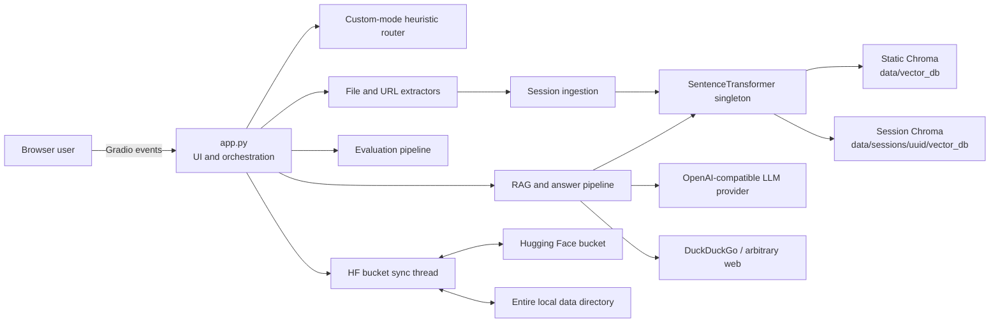
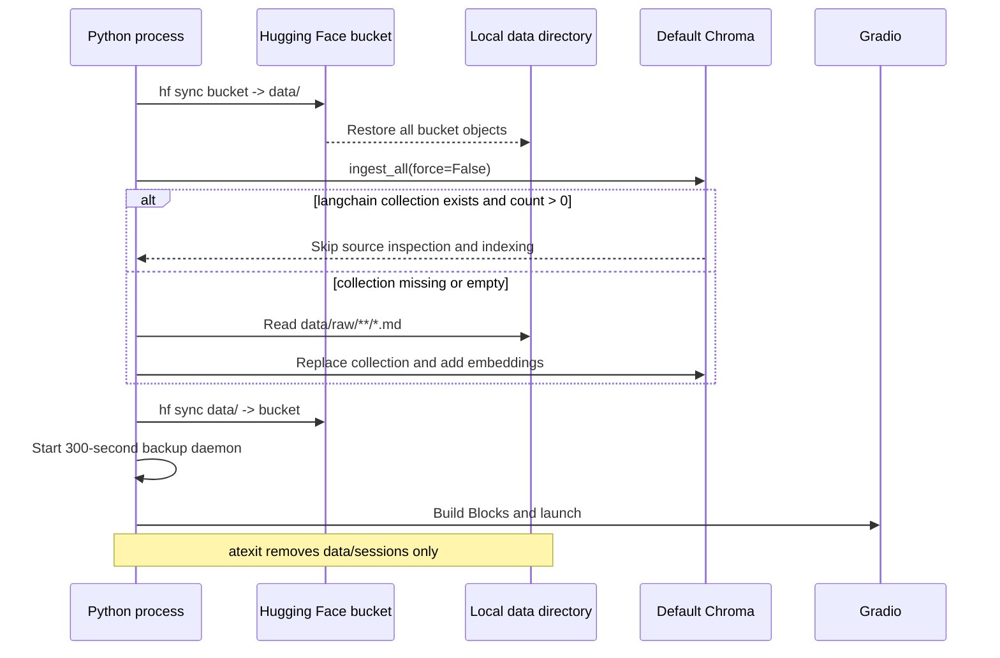
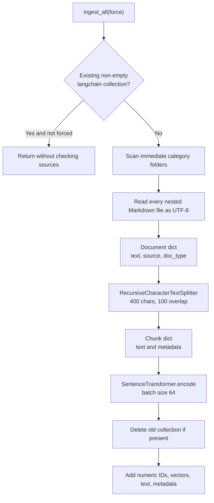
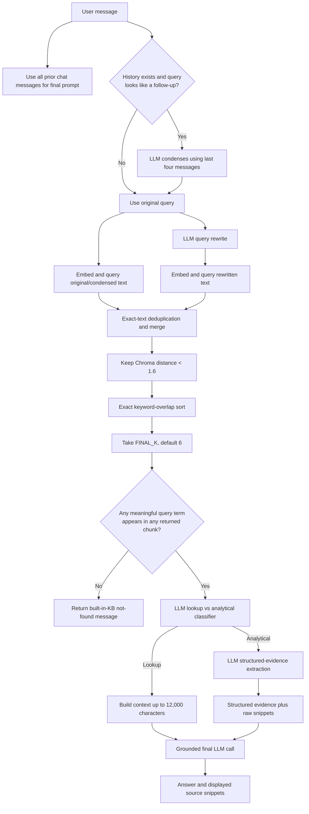
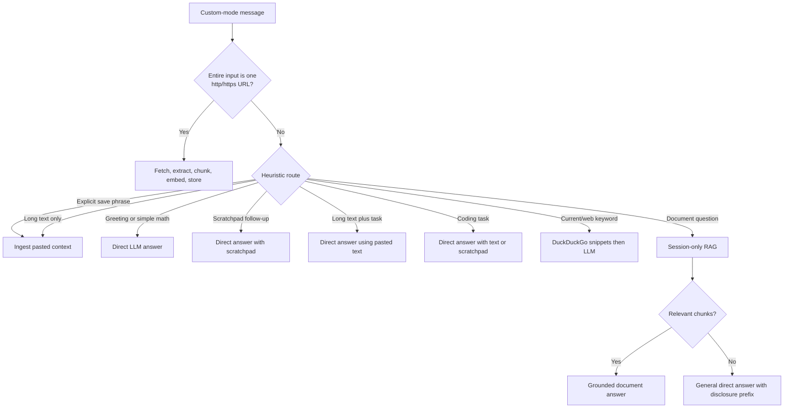
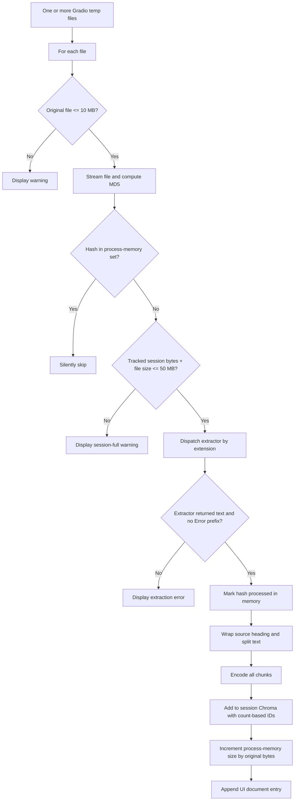
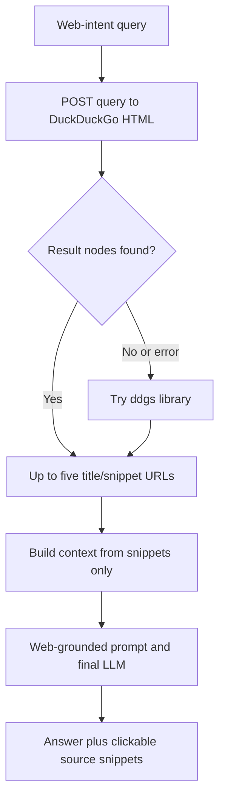
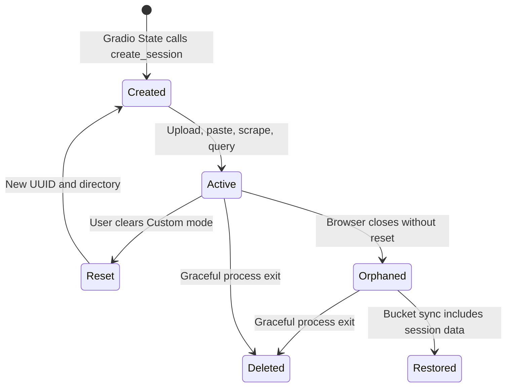
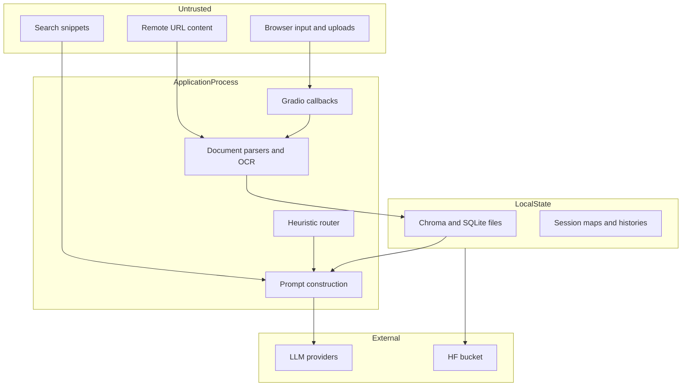

# Current Architecture And End-To-End Pipelines

## 1. System Shape

Knovera is a modular monolith at the source-code level and a single process
at runtime. Gradio renders the interface and invokes ordinary Python callback
functions. Those callbacks perform file reads, OCR, web requests, embeddings,
Chroma writes, retrieval, and LLM calls synchronously.



There is no separate HTTP API implementation, service layer, repository layer,
job worker, authorization layer, or durable metadata database. Gradio exposes
its own event transport around the Python callbacks.

## 2. Runtime Components

| Component | Responsibility | Important State |
|---|---|---|
| `app.py` | UI, mode selection, routing, uploads, session display, evaluation UI | Gradio states and global scratchpads |
| `core.config` | Environment loading and provider/retrieval configuration | Module-level constants |
| `core.answer` | Embedding, retrieval, reranking, prompt building, provider calls, web search | Cached embedder, default collection, LLM clients |
| `core.extractors` | PDF, DOCX, image, text, and URL extraction | Tesseract executable path |
| `core.ingest` | Static Markdown loading, chunking, and full collection replacement | Default Chroma collection |
| `core.session_ingest` | Per-session chunking and vector insertion | Session Chroma collection |
| `core.session_manager` | Session UUIDs, directories, client cache, size, and dedup state | Four process-memory dictionaries |
| `core.sync_manager` | Whole-directory restore and periodic backup | Daemon thread and HF bucket URI |
| `evaluation.eval` | Retrieval metrics and optional LLM judging | Cached LM Studio judge |
| `evaluation.test` | JSONL validation and loading | `TestQuestion` records |

## 3. Startup And Shutdown

Entry point: `app.main()` at `app.py:598`.



### Startup implications

1. `restore_from_bucket()` runs before static indexing. A remote copy can
   overwrite or add local raw data, the default vector database, and old session
   directories.
2. `ingest_all()` only checks that the collection exists and is non-empty. It
   does not compare source hashes, source modification times, embedding model,
   chunk settings, or schema versions.
3. `backup_to_bucket()` uploads the entire `data/` tree immediately after
   startup and again every five minutes.
4. Startup continues after sync failures, because sync errors are printed and
   swallowed.
5. UI readiness waits for restore, possible model download/indexing, and initial
   backup.
6. `atexit.register(clear_all_sessions)` is best-effort. Abrupt termination,
   container eviction, or process crashes do not guarantee cleanup.

### Shutdown implications

`clear_all_sessions()` deletes the session root and clears size and processed
file maps. It does not explicitly close Chroma clients or clear the client cache
and scratchpad map. Directory removal uses `ignore_errors=True`, so locked files
can remain without any alert.

## 4. Static Knowledge-Base Ingestion

Entry point: `core.ingest.ingest_all()`.



### Input

- Root: `data/raw/`, configurable through `KNOWLEDGE_BASE`.
- Supported static source type: Markdown only.
- Category: the name of each immediate subdirectory.
- Current corpus: 76 documents across company, contracts, employees, and
  products.

### Transformation

- Splitting is character-based, not token-, sentence-, page-, or
  heading-aware.
- Metadata contains:

```json
{
  "source": "absolute-or-configured-file-path",
  "doc_type": "category-directory-name"
}
```

- Chunk IDs are regenerated as `"0"`, `"1"`, and so on for every complete
  rebuild.

### Output

- Chroma path: `data/vector_db/` by default.
- Chroma collection: `langchain` by default.
- Stored fields: ID, embedding, document text, and metadata.
- The index directory is ignored by Git and absent from this checkout.

### Failure characteristics

- A forced rebuild deletes the existing collection before new embeddings are
  safely committed. Failure can leave no usable index.
- Empty files are skipped without a persisted manifest.
- One unreadable Markdown file aborts the scan.
- No document/chunk lineage or ingestion run record is stored.
- No source deletion/change detection exists when `force=False`.

## 5. Default-Mode Query Pipeline

Entry path:

`message.submit` -> `put_message_in_chatbot()` ->
`chat_with_mode()` -> `answer_question()`.



### Important implementation details

- The two vector searches are sequential, despite the README describing them as
  parallel.
- `fetch_context_unranked()` discards Chroma distances after applying the
  threshold. Later ranking cannot combine semantic distance with lexical score.
- Exact chunk text is the deduplication key.
- Keyword reranking replaces semantic order. Ties include source-name ordering.
- The relevance gate checks whether any selected chunk overlaps any query or
  rewrite term. It does not remove individually irrelevant chunks.
- The final prompt receives the complete previous chat history through
  `convert_to_messages(history)`. Only the condensation step limits history.
- Default mode does not use custom-session documents or web fallback.

### LLM call count

| Query shape | Typical LLM calls before/including answer |
|---|---:|
| Standalone lookup | Rewrite + intent + final answer = 3 |
| Follow-up lookup | Condense + rewrite + intent + final answer = 4 |
| Standalone analytical | Rewrite + intent + evidence extraction + final answer = 4 |
| Follow-up analytical | Condense + rewrite + intent + extraction + answer = 5 |

Each vector query also encodes independently, so the common path performs two
embedding calls. Exceptions in condensation and rewriting silently fall back to
the original question.

## 6. Custom-Mode Routing

Custom mode first gives a whole-input URL special treatment. All other text is
classified by deterministic heuristics in `route_custom_message()`.



### Route precedence

Order matters:

1. Explicit ingest phrase.
2. Exact greeting.
3. Simple arithmetic.
4. Scratchpad follow-up.
5. Long text containing task or code markers.
6. Other code task.
7. Web/current-information phrase.
8. Other long text.
9. Common explanatory prefix, routed based on whether the UI document list
   appears non-empty.
10. Default to document question.

The router uses UI Markdown (`current_docs_md`) as a proxy for whether documents
exist. It does not ask Chroma or a document registry.

## 7. Custom File Upload Pipeline

Entry point: `handle_upload()` at `app.py:403`.



### Supported upload UI types

PDF, DOCX, TXT, Markdown, PNG, JPG, and JPEG. The extractor also recognizes
WEBP, TIFF, CSV, and JSON, but the Gradio upload component does not advertise
those formats.

### Data retained

- Chroma chunk text and embeddings under the session UUID.
- Process-memory MD5 set.
- Process-memory byte counter.
- A display-only Markdown document list in Gradio state.

The original upload is a Gradio temporary file and is not deliberately copied
to managed application storage.

### Limits that are not limits

- The 50 MB counter tracks original file bytes, not extracted text, embeddings,
  SQLite growth, or scratchpad memory.
- Pasted input has no equivalent pre-ingestion 50 MB check.
- OCR and parser complexity are not bounded by page count, dimensions, token
  count, archive expansion, or processing time.
- A file is marked processed before `ingest_document()` completes, so an
  ingestion exception can make a retry appear to be a duplicate.

## 8. URL Ingestion Pipeline

When the complete message matches `^https?://[^\s]+$`:

1. `requests.get()` follows the URL with a browser-like user agent and a
   15-second timeout.
2. BeautifulSoup removes scripts, styles, images, inputs, navigation, footers,
   headers, asides, tables, forms, and buttons.
3. Remaining body text is prefixed with title and source URL.
4. Extracted UTF-8 byte size is checked against the process-memory session
   counter.
5. Text is wrapped again with a source heading, chunked, embedded, and stored.
6. The full extracted text, capped to its final 12,000 characters, becomes the
   session scratchpad.

No control prevents requests to loopback, RFC1918, link-local, cloud metadata,
or other internal addresses. Redirect destinations and response sizes are not
validated. This is an SSRF boundary, not just a scraper-quality concern.

## 9. Pasted Context And Scratchpad

Long text is defined as more than 500 characters or at least eight newline
characters. It is ingested unless task words or code markers cause a direct
answer.

Scratchpad shape:

```json
{
  "active_context": "last 12000 characters",
  "active_topic": "source or task label",
  "active_source": "user_input | url | pasted_text",
  "updated_at": "local ISO timestamp"
}
```

Scratchpads live in the global `_session_scratchpads` dictionary in `app.py`.
They are removed only on a custom-mode reset. They are not part of
`clear_all_sessions()`.

## 10. Session Document Query

Custom document questions call the same condensation, rewrite, retrieval,
reranking, intent, and final-answer logic as default mode, but select the
session's `session` Chroma collection.

If no chunks survive:

- `answer_question()` first creates a document-not-found message.
- `chat_with_mode()` discards that message and calls `answer_directly()`.
- The UI receives a prefixed general answer.

Therefore custom mode is document-first, not document-only. The general answer
may use model training data and does not cite documents.

`answer_question()` still contains code to save web fallback chunks into a
session, but the current UI calls it with `allow_web_fallback=False`.
Web-intent messages instead call `answer_from_web_search()`, which does not
persist results. The automatic web-ingestion branch is effectively dormant in
the current UI path.

## 11. Direct Answer Pipeline

Direct answers:

- Skip embeddings and retrieval.
- Optionally receive current pasted text or scratchpad text in the system
  prompt.
- Receive the complete prior history.
- Return no context documents.
- Convert provider errors into a user-visible message containing the first 200
  characters of the raw exception.

The math route does not evaluate arithmetic locally; it only routes arithmetic
text to an LLM.

## 12. Web Search Pipeline



The implementation tries HTML scraping before the `ddgs` client. Result pages
are not fetched, so the answer is grounded in search snippets. The prompt asks
the model to begin with a disclaimer and cite URLs, but that output contract is
not validated.

## 13. Evaluation Pipelines

### Dataset

`evaluation/tests.jsonl` contains:

| Category | Count |
|---|---:|
| `direct_fact` | 70 |
| `spanning` | 20 |
| `temporal` | 20 |
| `comparative` | 10 |
| `holistic` | 10 |
| `numerical` | 10 |
| `relationship` | 10 |

### Retrieval evaluation

For every test:

1. Call `fetch_context()` using the default local provider argument.
2. The rewrite stage attempts an LM Studio call and falls back on exception.
3. For each expected keyword, find the first retrieved chunk containing that
   substring.
4. Calculate a per-keyword reciprocal rank and binary nDCG.
5. Average keyword scores into one test result.

The README's "no LLM required" statement is only partly true. Retrieval metrics
can finish without an LLM because rewrite errors are swallowed, but the code
still attempts one LLM request per test.

### Answer evaluation

1. Generate an answer with the production `answer_question()` path.
2. Use a separately cached OpenAI SDK client pointed at LM Studio.
3. Ask that model to return JSON scores for accuracy, completeness, and
   relevance.
4. Parse the JSON into `AnswerEval`.

The same configured local model is normally both answer model and judge.
Scores have no Pydantic `1 <= score <= 5` constraint, and invalid or
unavailable judge output silently skips the test.

### Evaluation UI

Both full-suite evaluations are exposed as ordinary Gradio buttons. There is no
authentication, administrative role, concurrency control, run registry, result
persistence, or cost limit.

## 14. Session Lifecycle And Isolation



Isolation is based on unguessable UUIDs and separate local paths. It is not a
security authorization boundary:

- No user identity owns a session.
- No authorization check relates a browser request to the UUID.
- Registries are process-local.
- Multiple replicas do not share session state.
- Closing a browser does not trigger deletion.
- Whole-directory bucket backup can make session data durable and transferable.

## 15. Persistence And State Matrix

| State | Location | Durable? | Shared across replicas? | Cleanup |
|---|---|---:|---:|---|
| Built-in Markdown | `data/raw/` | Yes | Only through bucket/image | Never automatically |
| Default vectors | `data/vector_db/` | Local plus bucket | Only through bucket sync | Replaced on forced ingest |
| Session vectors | `data/sessions/<uuid>/vector_db/` | Intended no; actually bucket eligible | No coherent sharing | Reset or graceful exit |
| Session sizes | Python dictionary | No | No | Reset or graceful exit |
| Processed hashes | Python dictionary | No | No | Reset or graceful exit |
| Session clients | Python dictionary | No | No | Removed on reset; not global cleanup |
| Scratchpads | Python dictionary in `app.py` | No | No | Custom reset only |
| Default/custom chats | Gradio state | Browser-session lifetime | No | Mode clear or disconnect |
| Evaluation results | UI return values | No | No | UI lifecycle |
| LLM clients | Python dictionary | Process lifetime | No | Process exit |
| Embedding model | Python global/model cache | Process plus HF cache | No | Process exit/cache policy |

## 16. Concurrency And Scaling Model

The code assumes one process with one filesystem:

- Session IDs are per Gradio session, but metadata is in global dictionaries.
- `collection.count()` is used to allocate session chunk IDs. Concurrent writes
  to the same collection can select overlapping IDs.
- The dictionaries and client caches have no explicit locks.
- OCR, embeddings, LLM calls, scraping, and evaluation run inside callback
  execution rather than durable jobs.
- The sync thread can read SQLite files while application callbacks write them.
- Multiple application replicas would each restore, rebuild, back up, and
  periodically overwrite the same bucket namespace.

Horizontal scaling is therefore unsafe without replacing or externalizing these
state boundaries.

## 17. Trust Boundaries



Untrusted documents and web text are inserted directly into model context.
There is no prompt-injection classification, content policy, malware scanning,
PII classification, tenant policy, or output validation layer.

## 18. README Versus Implementation

| README statement | Implementation reality |
|---|---|
| Session workspace is fully isolated and ephemeral | Paths are separated, but data can be uploaded to the shared HF bucket and restored later |
| Server startup wipes sessions | Startup does not call `clear_all_sessions()`; bucket restore can recreate them |
| Dual searches run in parallel | They run sequentially |
| Static index is synchronized with raw data | Existing non-empty collection skips all source/version checks |
| Retrieval evaluation requires no LLM | It attempts query rewriting through the default LM Studio provider |
| Custom web fallback can populate the workspace | Current UI web path does not persist search snippets |
| Session size is capped at 50 MB | Counter excludes DB growth and pasted text is not prechecked |
| Pre-built static vector DB is committed | `data/vector_db/` is ignored and absent from this checkout |

## 19. Current Strengths

- Small repository with understandable boundaries.
- Lazy loading avoids model work during module import.
- Explicit strict-grounding and conflict-disclosure prompts.
- Separate default and custom histories.
- Per-session Chroma client reuse addressed earlier SQLite locking failures.
- File content deduplication avoids repeat uploads within one process.
- Retrieval refuses empty context rather than asking the LLM to improvise.
- A meaningful synthetic corpus and 150-case evaluation dataset already exist.
- Provider abstraction uses an OpenAI-compatible interface, which eases
  replacement.

These are good foundations for an evolutionary migration, but they should not
be mistaken for production isolation, durability, or observability.

