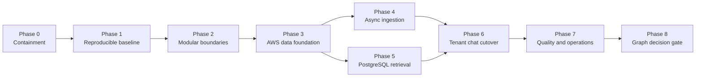

# Production Migration Roadmap

## 1. Migration Principles

1. **Contain privacy and security risk before improving answer quality.**
2. **Preserve behavior long enough to measure change, not forever.**
3. **Migrate from authoritative source documents, never by copying live Chroma
   or SQLite files.**
4. **Keep one deployable application and one worker for the pilot.**
5. **Make every data and model artifact versioned and reproducible.**
6. **Require tenant isolation tests at every persistence/retrieval boundary.**
7. **Use shadow comparison and feature flags before changing answer traffic.**
8. **Do not add a graph database, Redis, OpenSearch, or Kubernetes without a
   measured requirement.**

## 2. Workstream Overview



No phase begins production traffic until its entry dependencies and exit
criteria are met.

## 3. Phase 0: Immediate Containment

**Goal:** Prevent prototype behavior from creating avoidable privacy, network,
or data-integrity incidents.

### Changes

1. Stop automatic restore/backup of the whole `data/` directory.
2. At minimum exclude `data/sessions/`; preferably remove live database sync
   completely.
3. Inventory and review the existing Hugging Face bucket for historical session
   database content. Delete it under an approved process.
4. Disable arbitrary URL ingestion and web search in any shared/deployed
   environment.
5. Restrict the current Gradio app to authenticated/internal access while the
   production identity boundary is built.
6. Remove evaluation actions from untrusted users.
7. Add explicit provider timeouts and stop returning raw exception/context data
   to users.
8. Document that current browser-session deletion does not prove remote/backed
   data deletion.

### Acceptance criteria

- No code path uploads `data/sessions` or an active Chroma/SQLite directory.
- Network tests prove loopback, link-local, RFC1918, metadata, and arbitrary
  external URLs cannot be fetched by the deployed application.
- Anonymous users cannot reach chat, upload, or evaluation.
- Existing remote session artifacts have an auditable disposition.
- Provider failures return stable safe errors without raw context.

### Rollback

There is no production rollback to unsafe session synchronization or URL
fetching. For local demos, rebuilding `data/vector_db` from `data/raw` is the
fallback.

## 4. Phase 1: Reproducible Engineering Baseline

**Goal:** Make the existing behavior buildable, testable, and observable before
refactoring.

### Changes

1. Introduce `pyproject.toml` with a declared Python range and separated runtime,
   development, and evaluation dependencies.
2. Produce a lock file with exact versions and hashes where tooling supports
   them.
3. Create a non-root multi-stage container image including an explicit
   Tesseract package/version.
4. Add format, lint, static type, unit-test, dependency, secret, and container
   scans to CI.
5. Add a validated settings model and remove deployed `.env` override behavior.
6. Define normalized application errors and structured JSON logging.
7. Capture a baseline evaluation run with:
   - Current commit
   - Corpus manifest/hash
   - Embedding model
   - Chunk/retrieval settings
   - Prompt hashes
   - Provider/model
   - Retrieval and answer results
   - Latency and token counts
8. Add characterization tests around current routing and retrieval before moving
   code.

### Minimum characterization tests

- Default mode never uses session or web context.
- Custom file, URL-disabled, paste-ingest, paste-task, code, math, follow-up,
  document, no-hit, and web-disabled routes.
- Default/custom histories remain separate.
- Custom reset creates a new session ID and clears scratchpad.
- Duplicate file behavior.
- Empty/extractor-error behavior.
- Provider failure behavior.
- Lookup and analytical call paths.

### Acceptance criteria

- Clean checkout builds from the lock file and container without floating
  dependency resolution.
- CI is green and produces an SBOM and signed/scanned image.
- Settings validation fails startup with an actionable error.
- Baseline results and manifests are stored as immutable CI artifacts.
- Refactoring tests describe current intentional behavior and known defects.

## 5. Phase 2: Modular Monolith Boundaries

**Goal:** Separate application behavior from Gradio and infrastructure without
changing the storage backend yet.

### Changes

1. Move route decisions and policies from `app.py` into an application service.
2. Replace route strings with `RouteDecision` enum/model:

```text
route, reason_code, uses_retrieval, uses_active_context,
grounding_mode, web_allowed, direct_allowed
```

3. Replace callback positional tuples with named application results.
4. Introduce domain models for documents, chunks, provenance, conversations,
   citations, provider errors, and retrieval candidates.
5. Extract ports for model, embedding, retrieval, document store, session store,
   queue, and audit.
6. Wrap existing Chroma, local filesystem, and OpenAI-compatible behavior in
   adapters.
7. Build FastAPI routes that call the same application services as Gradio.
8. Mount Gradio at `/ui`; keep it as the pilot frontend.
9. Move evaluation to an application service with an admin policy, even before
   it becomes asynchronous.

### Compatibility rules

- Existing Default and Custom labels remain available in Gradio.
- Current static corpus answers remain comparable.
- No route imports Gradio types below the UI adapter.
- No domain/application module imports Chroma, boto3, SQLAlchemy, or provider
  SDKs.
- Every request gets request/correlation IDs.

### Acceptance criteria

- API and Gradio produce equivalent route decisions and answer behavior for the
  characterization suite.
- Application services run in tests without Gradio.
- Infrastructure adapters can be replaced with in-memory fakes.
- Import dependency checks enforce layer direction.
- API OpenAPI schema contains all public request/response/error models.

### Rollback

Keep the old Gradio callback adapter behind a short-lived feature flag until API
and UI characterization parity is green. Do not maintain duplicate orchestration
after phase exit.

## 6. Phase 3: AWS Identity And Data Foundation

**Goal:** Establish secure tenant-aware infrastructure before moving documents.

### Infrastructure

Terraform creates:

- VPC, two-AZ subnets, route tables, security groups, endpoints
- ALB, ACM, WAF
- Cognito user pool/client/domain and federation hooks
- ECS cluster, ECR, API and worker task/service definitions
- RDS PostgreSQL Multi-AZ with KMS and backups
- S3 quarantine, documents, and audit buckets
- SQS ingestion queue and DLQ
- Secrets Manager records and least-privilege task roles
- CloudWatch log groups, dashboards, alarms
- CloudTrail/security log delivery

### Database

1. Enable `vector` and required safe extensions.
2. Create Alembic migrations for identity, tenant, document, job, conversation,
   chunk, citation, trace, outbox, and audit tables.
3. Enable and force RLS on every tenant table.
4. Create separate migration, application, worker, read-only/admin, and audit
   roles.
5. Add connection-pool limits and TLS verification.
6. Seed one system scope for the built-in corpus.

### Identity

1. Validate Cognito/OIDC tokens in FastAPI.
2. Map subjects to tenant memberships and roles.
3. Require explicit tenant context.
4. Verify ALB auth headers if used.
5. Log authn/authz decisions without logging tokens.

### Acceptance criteria

- Anonymous, expired, wrong-audience, wrong-issuer, and tampered tokens fail.
- A user outside a tenant cannot read any tenant resource by ID or list/filter.
- Direct SQL integration tests prove RLS blocks cross-tenant access even when
  application filters are omitted.
- API/worker roles cannot disable or bypass RLS.
- Buckets have public access blocked, KMS, TLS-only policies, and expected
  lifecycle/versioning.
- RDS restore test succeeds and preserves extensions, schema, and policies.
- Terraform policy checks prevent public RDS/ECS and unrestricted IAM.

## 7. Phase 4: Durable Asynchronous Ingestion

**Goal:** Replace synchronous upload/extract/embed callbacks with a secure,
idempotent pipeline.

### Work packages

#### Upload API

- Create upload intent and presigned PUT.
- Generate object key server-side.
- Enforce file/batch/tenant quotas before signing.
- Verify S3 object, size, checksum, and expected metadata on completion.
- Commit document version, job, and outbox event atomically.

#### Worker

- Consume standard SQS messages.
- Set tenant context and claim job with compare-and-set.
- Validate type/signature and scan malware.
- Enforce pages, image pixels, extracted bytes, token and chunk limits.
- Run extractors with process/resource timeout.
- Emit normalized blocks with page/section/table provenance.
- Produce token-aware child chunks and hashes.
- Batch Titan embeddings.
- Insert version/chunks and atomically activate.
- Store normalized artifact and ingestion manifest in S3.
- Normalize errors, retry transient failures, and DLQ final failures.

#### Document lifecycle

- List/detail/status API.
- Reindex from immutable original.
- Replace version without retrieval downtime.
- Delete workflow across chunks, citations, S3 objects, and caches.
- TTL and reaper for abandoned uploads.

### Existing corpus migration

Do not copy `data/vector_db`.

1. Generate a manifest for all 76 `data/raw` Markdown files:
   logical source ID, category, SHA-256, size, and current Git commit.
2. Upload immutable originals into the S3 system scope.
3. Run the same production ingestion pipeline.
4. Store Git path/commit as source lineage.
5. Verify exactly one indexed active version per source.
6. Re-run retrieval evaluation against the PostgreSQL index.

### Existing custom sessions

Do not migrate current `data/sessions`:

- There is no authenticated tenant owner.
- Retention consent/policy is absent.
- Content may have been synchronized remotely already.

Delete under the Phase 0 disposition process. If a user needs a document, they
must re-upload it through the authenticated pipeline.

### Acceptance criteria

- Duplicate completion/event delivery produces one active version and one
  consistent chunk set.
- Worker termination at every stage safely retries or reaches DLQ.
- Old active document version remains queryable until replacement activation.
- Malware/type/quota failures never become retrievable.
- No raw document content appears in SQS or ordinary logs.
- Job status/progress is durable and authorized.
- Delete hides data from retrieval immediately and completes all policy-allowed
  stores asynchronously.

### Rollback

Disable new uploads while preserving already indexed data. Redrive retryable
jobs after correction. Never fall back to unaudited local session ingestion in
production.

## 8. Phase 5: PostgreSQL Hybrid Retrieval

**Goal:** Replace Chroma reads with tenant-authorized, versioned hybrid
retrieval.

### Implementation

1. Add `PgvectorRetrievalRepository`.
2. Add tenant/scope and active-version predicates to every query.
3. Create full-text GIN and vector HNSW indexes.
4. Generate vector and lexical candidate lists.
5. Apply reciprocal-rank fusion.
6. Apply parent/source diversity.
7. Preserve all scores and provenance in `RetrievalTrace`.
8. Build context using tokenizer budgets and stable citation IDs.
9. Add structured answer/citation validation.
10. Add evidence-threshold abstention.

### Feature flags

```text
RETRIEVAL_BACKEND=chroma | postgres_shadow | postgres
EMBEDDING_BACKEND=sentence_transformer | bedrock
ANSWER_BACKEND=openai_compatible | bedrock
DIRECT_MODE_ENABLED=false
WEB_MODE_ENABLED=false
```

Flags are environment deployment controls, not user-supplied request values.

### Shadow comparison

`postgres_shadow` keeps Chroma's answer path but runs authorized PostgreSQL
retrieval asynchronously/in parallel for synthetic/system queries. It records:

- Candidate overlap
- Relevant document/chunk recall
- Rank changes
- No-hit/abstention disagreement
- Latency
- Index/model/config versions

Do not shadow real tenant content into an unauthorized legacy store.

### Release gates

On the held-out system-KB suite:

- Recall@10 is no worse than baseline by more than 2 percentage points.
- MRR/nDCG meet agreed release thresholds.
- Citation IDs resolve and are authorized in 100 percent of cases.
- Expected abstention false-answer rate improves or does not regress.
- p95 retrieval latency meets the budget.
- Cross-tenant adversarial suite has zero leaks.
- Embedding and index versions are present in every trace.

### Cutover

1. Enable PostgreSQL retrieval for internal users.
2. Enable for one synthetic/test tenant.
3. Enable for a small percentage of eligible system-KB conversations.
4. Observe at least one full operational window.
5. Expand while monitoring SLO and quality alarms.
6. Set PostgreSQL as default.
7. Keep Chroma read-only only for the defined rollback window.
8. Remove Chroma and HF sync dependencies after exit criteria.

### Rollback

Feature-flag system-KB traffic back to read-only Chroma during the rollback
window. Tenant content remains in PostgreSQL/S3; do not copy it into Chroma for
rollback.

## 9. Phase 6: Tenant Conversations And Production Cutover

**Goal:** Make durable authenticated tenant Q&A the normal user path.

### Changes

- Persist conversations, bounded summaries, messages, citations, and traces.
- Enforce owner/role and tenant RLS.
- Replace global scratchpads with persisted bounded conversation context.
- Add SSE streaming and disconnect cancellation.
- Implement explicit modes:
  `system_kb`, `tenant_kb`, and policy-controlled `direct`.
- Make document no-hit an abstention; never silently convert it to a general
  answer.
- Remove provider dropdown in production UI.
- Add usage/quota reporting and admin-only evaluation.
- Remove process-local session size/hash/client/scratchpad registries.
- Remove startup bucket restore, static auto-ingestion, and background sync.

### Acceptance criteria

- Restart and horizontal scaling do not lose document/job/chat state.
- Two API replicas return consistent authorized results.
- Conversation history respects token/retention limits.
- Tenant KB no-hit never calls direct mode unless the user explicitly chose it
  and policy allows it.
- Provider/model selection is deployment policy and appears in traces.
- Manual reset/delete uses the durable deletion workflow.
- Gradio uses the same application services and authorization as the API.

### Rollout

- Start with system KB.
- Add one pilot tenant with synthetic documents.
- Complete tenant security and deletion review.
- Add approved real pilot data.
- Hold a production-readiness review against all P0/P1 findings.

## 10. Phase 7: RAG Quality And Operations

**Goal:** Tune the secure architecture and establish continuous quality.

### Retrieval improvements, in order

1. Calibrate token chunk sizes by document type.
2. Add heading/page/table-aware parent-child retrieval.
3. Tune vector/FTS candidate counts and RRF.
4. Add query rewriting only for measured intents.
5. Add diversity/MMR if duplicate evidence remains high.
6. Evaluate a reranker; enable only if gains justify latency/cost.
7. Add structured fact extraction for named analytical use cases.
8. Add answer/citation repair only when validation fails, with a strict extra
   call budget.

### Evaluation improvements

- Label expected source documents/chunks.
- Add held-out and adversarial sets.
- Add unsupported questions and expected abstentions.
- Add citation precision/recall and groundedness.
- Add parser fixtures for PDFs, scanned PDFs, DOCX tables, images, CSV/JSON.
- Add tenant isolation, prompt injection, poisoning, SSRF, deletion, provider
  failure, and quota cases.
- Use an independent judge plus human calibration.
- Persist run manifests and compare releases automatically.

### Operational improvements

- Autoscale workers from queue age/backlog.
- Tune ECS resources from measured OCR/embedding memory/CPU.
- Tune PostgreSQL pool/index/autovacuum using traces.
- Add provider circuit breaker and quota forecasts.
- Add per-tenant storage/token/cost budgets.
- Run backup restore, incident, deletion, and DLQ redrive drills.
- Review AWS Well-Architected Generative AI and Security controls.

### Acceptance criteria

- Release pipeline blocks quality/security/SLO regressions.
- Every production answer can be traced to authorized evidence, model/prompt,
  and retrieval/index versions.
- Alerts are actionable and have runbooks.
- Restore, deletion, provider outage, and queue recovery exercises pass.
- Cost per indexed document and answered query is visible by tenant.

## 11. Phase 8: Graph Database Decision

**Goal:** Decide from evidence whether Neptune is necessary.

### Prepare without deploying Neptune

- Define stable entity IDs and typed relation predicates.
- Store accepted structured facts/relationships in PostgreSQL with source chunk,
  extractor version, confidence, reviewer, and validity interval.
- Create at least 50 human-labelled multi-hop questions and expected paths.
- Implement PostgreSQL joins/recursive CTEs/materialized views first.
- Compare document RAG, structured SQL, and a small graph prototype.

### Adoption gate

Adopt Neptune only when:

- Graph queries are a committed product capability.
- PostgreSQL and hybrid retrieval miss the agreed target.
- Graph prototype improves multi-hop accuracy by at least 10 percentage points.
- p95 latency and cost remain inside budget.
- Tenant isolation, edge provenance, update consistency, deletion, backup, and
  schema ownership have passing designs/tests.

### If adopted

- PostgreSQL remains system of record.
- Publish versioned entity/relation changes through the outbox.
- Neptune stores derived graph projections, never orphan facts.
- Every edge carries source document/version/chunk and tenant/scope.
- Query service intersects graph results with authorized scope.
- Rebuild graph projection from PostgreSQL/S3 artifacts.

## 12. Suggested Pull Request Sequence

Each PR should be deployable, reviewed, and reversible where rollback is
allowed.

| PR group | Deliverable | Depends on |
|---|---|---|
| 0A | Disable unsafe bucket/session sync and URL/web routes | None |
| 0B | Safe provider errors/timeouts and access restriction | 0A |
| 1A | Packaging, lock, container, CI, settings | Phase 0 |
| 1B | Characterization and security test harness | 1A |
| 2A | Domain models, errors, route policy | 1B |
| 2B | Ports/adapters and application services | 2A |
| 2C | FastAPI and mounted Gradio adapters | 2B |
| 3A | Terraform network, identity, edge, compute | 1A |
| 3B | RDS/S3/SQS/KMS/observability | 3A |
| 3C | Schema, roles, RLS, auth integration | 2C, 3B |
| 4A | Upload intent/finalization and outbox | 3C |
| 4B | Worker scan/extract/chunk/embed/index | 4A |
| 4C | Version/reindex/delete lifecycle | 4B |
| 5A | Hybrid retrieval and traces | 4B |
| 5B | Context/citation/output validation | 5A |
| 5C | Shadow comparison and canary flags | 5B |
| 6A | Durable conversations and SSE | 3C, 5B |
| 6B | Production UI and legacy-state removal | 6A, 5C |
| 7+ | Quality tuning and graph experiment | Production baseline |

Avoid a single rewrite PR. Preserve traceability between behavior changes and
evaluation results.

## 13. Test And Release Matrix

| Area | Unit | Integration | Security/adversarial | Release evidence |
|---|---:|---:|---:|---|
| Settings/provider gateway | Yes | Yes | Secret/error leakage | Config manifest, timeout tests |
| Auth/RBAC/RLS | Yes | Yes | Cross-tenant IDs/filters | Zero-leak report |
| Upload/S3 | Yes | Yes | MIME, malware, quota | Object and policy tests |
| Ingestion/SQS | Yes | Yes | Duplicate, crash, poison | Redrive/idempotency report |
| Extractors | Yes | Fixtures | Parser bombs | Format coverage |
| Chunk/embedding | Yes | Bedrock test | Oversize input | Versioned index manifest |
| Retrieval | Yes | PostgreSQL | Unauthorized/poisoned chunks | Held-out ranking metrics |
| Answer/citations | Yes | Bedrock test | Prompt injection/disclosure | Grounding/citation metrics |
| Conversations | Yes | Multi-replica | Ownership/retention | Restart/expiry tests |
| Deletion | Yes | All stores | Legal hold/backup semantics | Deletion evidence |
| Observability | Yes | Fault injection | Log redaction | Dashboard/alarm checks |
| Backup/restore | N/A | Restore drill | Access after restore | Signed drill report |

## 14. Production Readiness Checklist

### Security and privacy

- [ ] No P0 finding remains open.
- [ ] Threat model and data-flow review approved.
- [ ] Cognito, RBAC, RLS, KMS, secrets, WAF, and private networking tested.
- [ ] Prompt injection, sensitive disclosure, SSRF, malware, and parser tests
      pass.
- [ ] Provider/model data handling is approved.
- [ ] Retention, deletion, legal hold, and backup semantics are documented.

### Reliability

- [ ] Multi-AZ API/RDS behavior tested.
- [ ] SQS retry, visibility extension, DLQ and redrive tested.
- [ ] Idempotency tested at every ingestion stage.
- [ ] Provider timeout/throttle/outage behavior tested.
- [ ] Restore meets RPO/RTO.
- [ ] Rollback feature flags and runbook tested.

### Quality

- [ ] Held-out retrieval/answer/citation gates pass.
- [ ] Expected abstention suite passes.
- [ ] No cross-tenant retrieval in adversarial suite.
- [ ] Prompt/model/embedding/index versions are recorded.
- [ ] Quality, latency, and cost are compared to baseline.

### Operations

- [ ] Dashboards, alarms, and runbooks are linked.
- [ ] On-call ownership is assigned.
- [ ] Tenant quotas and cost alerts are active.
- [ ] Dependency/image/SBOM scans pass.
- [ ] Infrastructure and database migrations are reviewed.
- [ ] Audit access and incident procedures are tested.

## 15. Ownership Model

| Area | Primary owner | Required reviewers |
|---|---|---|
| Domain/API and migration | Backend lead | Product, security |
| Retrieval/evaluation | RAG/ML engineer | Domain expert, backend |
| AWS/Terraform/operations | Platform engineer | Security, backend |
| Identity/RLS/data policy | Security and backend | Compliance/privacy |
| Extractors/upload security | Backend/security | Platform |
| Corpus/schema/domain facts | Product/domain owner | RAG engineer |
| Production readiness | Engineering lead | All above |

One person can hold multiple roles in a small team, but each responsibility must
still be explicit.

## 16. Documentation Traceability

| Question | Primary document |
|---|---|
| What is Knovera and how should I study it? | [Study Guide](README.md) |
| What happens from startup to answer? | [Current Architecture](current-architecture.md) |
| What does every module/function/config/model do? | [System Reference](system-reference.md) |
| Why were current choices made? | [Design Review](design-review.md) |
| What is unsafe or inefficient? | [Design Review](design-review.md) |
| What databases and AWS services should the pilot use? | [AWS Blueprint](aws-production-blueprint.md) |
| What APIs and schemas should be added? | [AWS Blueprint](aws-production-blueprint.md) |
| How should code/data move without a big-bang rewrite? | This roadmap |
| When should a graph database be added? | AWS blueprint and Phase 8 |
| What proves production readiness? | Test matrix and readiness checklist above |

## 17. Static Analysis Limitations

This documentation phase intentionally did not:

- Install `requirements.txt`
- Download the embedding model
- Build `data/vector_db`
- Launch Gradio
- Contact LM Studio, Groq, Mistral, Bedrock, DuckDuckGo, arbitrary URLs, or the
  Hugging Face bucket
- Run the 150 retrieval/answer evaluations
- Render Mermaid diagrams in a browser
- Perform load, security, dependency, or cloud cost testing

Observed checks:

- Python 3.11.9
- Syntax compilation passed for `app.py`, `core/`, and `evaluation/`
- All 150 evaluation JSONL rows validate and load
- Application import fails because Gradio and other project dependencies are not
  installed in the current environment
- Git worktree was clean before the documentation files were added

These limits must remain visible. Recommendations are implementation targets,
not claims that the target system has already been tested.

