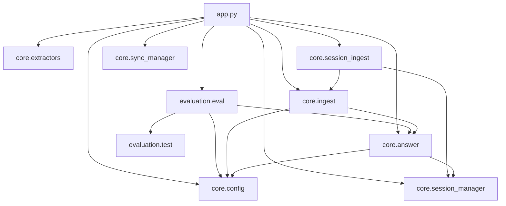

# System Reference

This document is the source-level catalog for Knovera. It describes what
each module exposes, how data is represented, where it is stored, and which
external systems are contacted.

## 1. Public Surface

### 1.1 User-facing interface

The only intentional public interface is the Gradio application built in
`app.main()`. There is no FastAPI, Flask, Django, or hand-written REST/GraphQL
API.

Gradio can generate network endpoints for event handlers internally, but those
routes are framework implementation details. The repository does not define,
version, authenticate, document, or test them as a stable application API.

### 1.2 UI controls and callback contracts

| UI event | Callback chain | Inputs | Outputs / side effects |
|---|---|---|---|
| Mode radio change | `toggle_mode` | Mode and both mode histories/contexts | Shows custom controls and restores selected history/context |
| Provider dropdown change | Identity lambda | Selected provider | Updates provider state |
| File upload | `handle_upload` | Files, session ID, document-list Markdown | Extracts and indexes files; updates document list, size, uploader |
| Message submit, stage 1 | `put_message_in_chatbot` | Text and visible chat history | Clears textbox and appends user message |
| Message submit, stage 2 | `chat_with_mode` | Visible history, mode, session and mode states, docs, provider | Routes, retrieves/ingests/calls LLM, updates eight UI/state outputs |
| Clear current chat | `reset_current_mode` | Mode, session and all mode states | Clears selected history; custom mode also destroys and recreates session |
| Retrieval evaluation click | `run_retrieval_evaluation` | Gradio progress injection | Runs all retrieval tests; returns metric HTML and DataFrame |
| Answer evaluation click | `run_answer_evaluation` | Gradio progress injection | Runs all answer tests; returns metric HTML and DataFrame |

The central `chat_with_mode()` callback returns:

```text
(
  visible_chat_history,
  visible_context_markdown,
  default_history_state,
  custom_history_state,
  default_context_state,
  custom_context_state,
  custom_document_list_markdown,
  custom_size_markdown
)
```

This positional tuple is an implicit UI contract. It has no named result type,
and branch correctness depends on returning values in exactly this order.

### 1.3 Launch behavior

`ui.launch()` receives:

- `ssr_mode=False`
- Theme in the launch arguments for Gradio 6+, otherwise in `Blocks`
- No explicit host, port, root path, auth function, TLS, concurrency limit,
  queue configuration, API visibility rule, or allowed-path policy

Default host/port behavior therefore comes from the installed Gradio version.
The README expects `127.0.0.1:7860`.

## 2. Module Dependency Map



Notable coupling:

- `core.ingest` imports the embedder from `core.answer`, so the answer module is
  also the embedding infrastructure module.
- `core.session_ingest` imports chunk configuration indirectly from
  `core.ingest`, even though those constants originate in `core.config`.
- `core.answer.answer_question()` performs local imports back into
  `core.session_manager` and `core.session_ingest`.
- `app.py` owns the custom router and scratchpad instead of a domain/application
  service.
- Evaluation imports production retrieval and answer functions directly.

## 3. `app.py` Reference

### 3.1 Constants

| Symbol | Value | Purpose |
|---|---:|---|
| `MAX_FILE_BYTES` | 10 MiB | Original upload-size check |
| `MAX_SESSION_BYTES` | 50 MiB | Process-memory session byte counter limit |
| `MAX_VISIBLE_DOCS` | 5 | Number of displayed document entries |
| `MRR_GREEN` / `MRR_AMBER` | 0.90 / 0.75 | Retrieval dashboard colors |
| `NDCG_GREEN` / `NDCG_AMBER` | 0.90 / 0.75 | Retrieval dashboard colors |
| `COVERAGE_GREEN` / `COVERAGE_AMBER` | 90 / 75 percent | Coverage colors |
| `ANSWER_GREEN` / `ANSWER_AMBER` | 4.5 / 4.0 | Answer score colors |
| `_URL_RE` | Whole HTTP(S) URL | Special URL-ingestion route |
| `_SIMPLE_MATH_RE` | Digits and arithmetic punctuation | Direct-route heuristic |

Task, ingestion, web, follow-up, chat, and code-marker sets are hardcoded in
this module. They are not configurable or localized.

### 3.2 Functions

| Function | Role and contract |
|---|---|
| `trim_docs_list(md_text)` | Splits document-list Markdown on blank lines and retains the latest five display entries |
| `extract_text_content(content)` | Converts Gradio string/list message content to plain text |
| `is_url(text)` | Accepts only a whole-input HTTP or HTTPS URL |
| `get_scratchpad(session_id)` | Returns/creates an untyped scratchpad dictionary in global memory |
| `set_scratchpad_context(...)` | Stores the final 12,000 characters and source metadata |
| `clear_scratchpad(session_id)` | Removes one global scratchpad |
| `has_session_documents(current_docs_md)` | Infers index presence from display text |
| `looks_like_math(text)` | Identifies simple arithmetic strings and four natural-language prefixes |
| `looks_like_code_task(text)` | Checks fixed markers or code tokens plus action words |
| `has_task_intent(text)` | Checks word-boundary matches against `_TASK_WORDS` |
| `has_ingest_intent(text)` | Checks fixed save/remember phrases |
| `has_web_intent(text)` | Checks current/latest/search phrases |
| `looks_like_followup_task(text, scratchpad)` | Uses scratchpad presence and broad substring matches |
| `route_custom_message(...)` | Returns one of eight route strings |
| `format_context(context)` | Renders source-labelled, 400-character chunk previews |
| `format_size(size_bytes)` | Converts bytes to a two-decimal MiB string |
| `chat_with_mode(...)` | Central orchestration callback for all chat and ingestion behavior |
| `put_message_in_chatbot(message, history)` | Appends a user message and clears textbox |
| `toggle_mode(...)` | Selects visible mode state and custom-panel visibility |
| `handle_upload(...)` | Validates, extracts, hashes, indexes, and displays uploaded files |
| `reset_current_mode(...)` | Clears selected mode; replaces custom session when needed |
| `_get_color(value, metric_type)` | Maps metric thresholds to CSS color names |
| `_metric_html(...)` | Creates raw HTML metric cards |
| `run_retrieval_evaluation(progress)` | Aggregates all retrieval cases for UI |
| `run_answer_evaluation(progress)` | Aggregates all answer cases for UI |
| `main()` | Executes startup synchronization/indexing and builds/launches Gradio |

### 3.3 Custom router outputs

| Route | Trigger | Handler behavior |
|---|---|---|
| `ingest_context` | Explicit save phrase or long text without task | Chunk and index text |
| `direct_answer` | Greeting or arithmetic | LLM without retrieval |
| `followup_task` | Scratchpad exists and follow-up token matches | LLM with scratchpad |
| `task_on_pasted_text` | Long text plus task/code intent | LLM with full pasted text |
| `coding_task` | Code heuristic | LLM with long prompt or scratchpad |
| `web_question` | Current/latest/web phrase | Search snippets then LLM |
| `document_question` | Explanatory prefix with docs or default route | Session RAG |

There are seven distinct returned values; the source comment describes a
"fast local router" but does not define an enum.

## 4. `core.config` Reference

`load_dotenv(override=True)` runs during import. Values in a local `.env` file
override already-set process environment variables. In managed deployments this
can unexpectedly replace injected secrets or service configuration.

### 4.1 LLM provider registry

| Display name | Base URL | Model | API key source |
|---|---|---|---|
| `Local (LM Studio)` | `LM_STUDIO_BASE` or `http://127.0.0.1:1234/v1` | `LM_MODEL` or `local-model` | `OPENAI_API_KEY` or literal `lm-studio` |
| `Groq - Llama 3.3 70B (Free)` | `https://api.groq.com/openai/v1` | `llama-3.3-70b-versatile` | `GROQ_API_KEY` |
| `Mistral - Small (Free)` | `https://api.mistral.ai/v1` | `mistral-small-latest` | `MISTRAL_API_KEY` |

Provider availability:

- Local always appears outside Hugging Face Spaces because it receives the
  fallback `lm-studio` key.
- Local is hidden when `SPACE_ID` exists.
- Groq and Mistral appear only when their key is non-empty.
- Mistral is moved to the first position in Hugging Face Spaces.
- If a Space has neither Groq nor Mistral configured, `AVAILABLE_PROVIDERS` is
  empty and `AVAILABLE_PROVIDERS[0]` fails during UI construction.

### 4.2 Environment variables

| Variable | Default | Used by | Present in `.env.example`? |
|---|---|---|---:|
| `LM_STUDIO_BASE` | `http://127.0.0.1:1234/v1` in registry | Local chat and judge clients | Yes |
| `LM_MODEL` | `local-model` | Local provider and judge model | Yes |
| `OPENAI_API_KEY` | `lm-studio` in registry | Local/OpenAI-compatible provider | Yes |
| `GROQ_API_KEY` | Empty | Groq provider availability | No |
| `MISTRAL_API_KEY` | Empty | Mistral provider availability | No |
| `SPACE_ID` | Unset | Hugging Face runtime detection | No |
| `DB_NAME` | `<repo>/data/vector_db` | Default Chroma client | No |
| `KNOWLEDGE_BASE` | `<repo>/data/raw` | Static source scanner | No |
| `COLLECTION_NAME` | `langchain` | Default collection | No |
| `EMBEDDING_MODEL_NAME` | `all-MiniLM-L6-v2` | SentenceTransformer | No |
| `RETRIEVAL_K` | `10` | Chroma candidates per query | No |
| `FINAL_K` | `6` | Final chunks after rerank | No |
| `MAX_CONTEXT_CHARS` | `12000` | Prompt context cap | No |
| `CHUNK_SIZE` | `400` | Both text splitters | No |
| `CHUNK_OVERLAP` | `100` | Both text splitters | No |
| `HF_HOME` | Library default | Transformer model cache | No |
| `HF_BUCKET_URI` | Hardcoded project bucket | Bucket restore/backup | No |
| `AI_EVAL_ENABLED` | Enabled unless exactly `false` | LLM-as-judge gate | Yes |

The README documents several optional variables that `.env.example` does not.
The example also comments that the local fields can be pointed at the real
OpenAI API, but the UI will still label that provider `Local (LM Studio)`.

## 5. `core.answer` Reference

### 5.1 Models and global state

```python
class Result(BaseModel):
    page_content: str
    metadata: dict
```

`metadata` is untyped. Current code expects some combination of:

- `source: str`
- `doc_type: str`
- `session: str` for session uploads

Module globals:

| Symbol | Content | Lifecycle |
|---|---|---|
| `embedder` | One `SentenceTransformer` | Lazy, process lifetime |
| `collection` | Default Chroma collection | Lazy, process lifetime |
| `_llm_cache` | Provider name to `ChatOpenAI` | Lazy, process lifetime |
| `_chroma_cache` | Empty dictionary | Declared but unused |
| `WEB_SEARCH_K` | `5` | Fixed search result cap |
| `_STOP_WORDS` | Hand-built English terms | Fixed retrieval heuristic |
| `_FOLLOWUP_SIGNALS` | Pronoun/reference words | Fixed condensation heuristic |

`lru_cache`, `Path`, and `KNOWLEDGE_BASE` are imported but unused in the
current module.

### 5.2 Prompts

| Prompt | Used for | Key rules |
|---|---|---|
| `SYSTEM_PROMPT` | Document-grounded answer | Context-only, conflicts, evidence discipline, source names |
| `WEB_FALLBACK_PROMPT` | Search-grounded answer | Exact disclaimer, snippets-only facts, URL citation |
| `DIRECT_ANSWER_PROMPT` | General/task answer | Optional active context, no false upload claims |
| Inline rewrite prompt | Query rewrite | One sentence and output-only query |
| Inline condensation prompt | Follow-up rewrite | Last four eligible messages |
| Inline classification prompt | Input context/query | Present but no longer used by UI |
| Inline intent prompt | Lookup/analytical | Output-only label |
| Inline extraction prompt | Analytical evidence | Markdown table/list before final answer |

Prompts are code constants, without IDs, versions, change logs, or evaluation
linkage.

### 5.3 Functions

| Function | Role and behavior |
|---|---|
| `get_embedder()` | Loads the configured SentenceTransformer, optionally using `HF_HOME` |
| `get_collection()` | Opens/creates the default collection |
| `get_arbitrary_collection(session_id)` | Gets a cached per-session client and the `session` collection |
| `get_llm(provider)` | Creates/caches a temperature-zero `ChatOpenAI` client |
| `fetch_context_unranked(question, session_id)` | Encodes one query, asks Chroma for `RETRIEVAL_K`, filters distance `< 1.6` |
| `merge_chunks(chunks1, chunks2)` | Preserves first list and appends exact-text-unique second-list chunks |
| `rewrite_query(question, provider)` | LLM rewrite with original-query fallback |
| `condense_question(question, history, provider)` | Heuristic follow-up detection and LLM standalone rewrite |
| `rerank(question, chunks)` | Sorts by exact content-term overlap, source-term overlap, and source |
| `fallback_web_search(query)` | HTML search first, `ddgs` second |
| `_fallback_web_search_html(query)` | Scrapes up to five DuckDuckGo result nodes |
| `_unwrap_search_result_url(url)` | Resolves DuckDuckGo `uddg` redirect targets |
| `fetch_context(question, session_id, provider)` | Rewrite, two searches, merge, lexical rerank, overlap gate |
| `_filter_relevant_chunks(...)` | Custom-mode rerank and overlap gate |
| `fetch_context_with_options(...)` | Selects strict session or default retrieval and optional web fallback |
| `build_context(chunks, max_chars)` | Adds source headers and truncates by character count |
| `answer_directly(...)` | Direct LLM call with optional active context |
| `answer_from_web_search(...)` | Search, build prompt, call LLM, return LangChain documents |
| `classify_input(text, provider)` | Old context/query classifier; currently unused by UI |
| `classify_question_intent(...)` | LLM or keyword fallback for lookup/analytical |
| `extract_analytical_structure(...)` | LLM evidence extraction over selected chunks |
| `answer_question(...)` | Full RAG orchestration and final answer |

### 5.4 LLM client behavior

`ChatOpenAI` is constructed with:

- `temperature=0`
- Provider model, URL, and key

It does not explicitly set:

- Request/connect/read timeouts
- Retry count or backoff
- Maximum output tokens
- Organization/project headers
- Provider-specific rate limits
- Tracing metadata
- Per-tenant credentials or budget

All callers are synchronous. Raw exception text is partly returned to users for
direct, web, and grounded answers.

## 6. `core.extractors` Reference

### 6.1 Optional dependencies

Imports are individually guarded:

- `fitz` for PDFs
- `docx` for Word
- `pytesseract` and Pillow for images

Tesseract lookup order:

1. Executable in `PATH`
2. Two common Windows installation locations
3. `/usr/bin/tesseract`
4. `/usr/local/bin/tesseract`

### 6.2 Extractor functions

| Function | Input | Output and limitations |
|---|---|---|
| `extract_pdf(path)` | PDF path | Concatenated page text; no page metadata, OCR fallback, table model, or page limit |
| `extract_docx(path)` | DOCX path | Paragraph text only; misses tables, headers, footers, text boxes, comments |
| `extract_image(path)` | Image path | Tesseract plain text; no dimension/pixel/time/language control |
| `extract_txt(path)` | Text-like path | UTF-8 with Latin-1 fallback |
| `structure_as_markdown(text, source)` | Extracted text | Prepends an H1 source label |
| `extract_url(url)` | HTTP(S) URL | Title/source/body text after aggressive tag removal |
| `extract_file(path)` | Any path | Extension dispatch or an `Error:` string |

Errors are returned as ordinary strings beginning with `Error:` rather than
typed exceptions/results.

### 6.3 Extension dispatch

| Extensions | Handler |
|---|---|
| `.pdf` | PDF |
| `.png`, `.jpg`, `.jpeg`, `.webp`, `.tiff` | OCR |
| `.docx` | DOCX |
| `.txt`, `.md`, `.csv`, `.json` | Plain text |

Backend validation trusts the extension and does not inspect MIME type or file
signature.

## 7. Ingestion References

### 7.1 `core.ingest`

| Function | Contract |
|---|---|
| `fetch_documents()` | Returns list of `{text, source, doc_type}` dictionaries from Markdown |
| `create_chunks(documents)` | Returns `{text, metadata}` chunks using configured character split |
| `create_embeddings(chunks)` | Replaces the default collection and stores all vectors |
| `ingest_all(force=False)` | Skips a non-empty collection or runs complete ingestion |

`get_embedder`, `CHUNK_SIZE`, and `CHUNK_OVERLAP` are re-exported accidentally
because `session_ingest` imports them from this module.

### 7.2 `core.session_ingest`

| Function | Contract |
|---|---|
| `get_session_collection(session_id)` | Returns/creates collection `session` |
| `ingest_document(text, source_name, session_id)` | Splits, embeds, and adds chunks; returns chunk count |

Session chunk metadata:

```json
{
  "source": "display source name",
  "doc_type": "user_upload",
  "session": "uuid"
}
```

All pasted text, scraped pages, files, and automatically stored web snippets use
`doc_type=user_upload`; ingestion source type is not preserved in Chroma.

Session IDs start at `collection.count()`. IDs are stable only until concurrent
writes or deletion behavior changes the relationship between count and prior
numeric IDs.

`PersistentClient` is imported directly but unused after the shared client-cache
change.

## 8. `core.session_manager` Reference

### 8.1 Filesystem

Session root:

```text
<repository>/data/sessions/<session_uuid>/vector_db/
```

The module imports `tempfile`, but session storage was changed back from the
system temporary directory to the repository data directory when bucket sync
was added.

### 8.2 Registries

| Registry | Type | Meaning |
|---|---|---|
| `_session_sizes` | `dict[str, int]` | Tracked accepted source bytes |
| `_session_processed_files` | `dict[str, set[str]]` | MD5 upload hashes |
| `_session_clients` | Untyped dictionary | Chroma client per session |

The fourth session registry, `_session_scratchpads`, is in `app.py`.

### 8.3 Functions

| Function | Role |
|---|---|
| `get_session_client(session_id)` | Lazy one-client-per-session cache |
| `create_session()` | UUID4, directory creation, size/hash initialization |
| `destroy_session(session_id)` | Best-effort directory removal and map cleanup |
| `get_session_db_path(session_id)` | Constructs the vector DB path without validating ownership |
| `get_session_size(session_id)` | Returns tracked bytes or zero |
| `add_to_session_size(session_id, bytes)` | Adds bytes without atomicity or ceiling enforcement |
| `is_file_processed(session_id, filename)` | Tests supplied key in process-memory set |
| `mark_file_processed(session_id, filename)` | Adds supplied key |
| `clear_all_sessions()` | Removes root and clears size/hash maps |

The `filename` parameters actually receive MD5 digests.

## 9. `core.sync_manager` Reference

### 9.1 Storage locations

| Symbol | Default |
|---|---|
| `LOCAL_DATA_DIR` | Entire `<repository>/data` directory |
| `HF_BUCKET_URI` | `hf://buckets/arcreactor19/knovera-storage` |

### 9.2 Functions

| Function | Operation |
|---|---|
| `restore_from_bucket()` | `hf sync <bucket> <local-data>` |
| `backup_to_bucket()` | `hf sync <local-data> <bucket>` |
| `start_background_sync(interval_seconds=300)` | Starts an endless daemon that calls backup |

On Windows, `subprocess.run` uses `shell=True` even though arguments are already
provided as a list. Paths are constants/environment-derived rather than user
input, but invoking the shell is unnecessary.

There is no:

- Inter-process/distributed lock
- Snapshot or database checkpoint
- Include/exclude filter
- Version manifest
- Conflict policy
- Delete policy
- Integrity verification
- Authentication preflight
- Retry/backoff
- Success metric
- Thread stop event

## 10. Evaluation Reference

### 10.1 Models

```python
class TestQuestion(BaseModel):
    question: str
    keywords: list[str]
    reference_answer: str
    category: str
```

```python
class RetrievalEval(BaseModel):
    mrr: float
    ndcg: float
    keywords_found: int
    total_keywords: int
    keyword_coverage: float
```

```python
class AnswerEval(BaseModel):
    feedback: str
    accuracy: float
    completeness: float
    relevance: float
```

### 10.2 `evaluation.test`

| Symbol | Role |
|---|---|
| `TEST_FILE` | Absolute path to `tests.jsonl` |
| `load_tests()` | Parses every non-empty assumed line as JSON and validates it |

Blank lines or malformed JSON abort loading.

### 10.3 `evaluation.eval`

| Function | Role |
|---|---|
| `_get_judge_client()` | Probes LM Studio with `models.list()` and caches client |
| `_coerce_answer_eval(raw)` | Parses judge JSON and converts score fields to float |
| `safe_console_text(value)` | Replaces characters unsupported by cp1252 |
| `calculate_mrr(keyword, docs)` | Reciprocal rank of first substring match |
| `calculate_dcg(relevances, k)` | Binary discounted cumulative gain |
| `calculate_ndcg(keyword, docs, k)` | Per-keyword nDCG over returned results |
| `evaluate_retrieval(test, k)` | Computes averaged keyword metrics |
| `evaluate_answer(test)` | Generates answer and optionally judges it |
| `evaluate_all_retrieval()` | Generator yielding case, result, progress |
| `evaluate_all_answers()` | Generator yielding case, result, progress |
| `run_cli_evaluation(test_number)` | Prints one full case |
| `main()` | CLI argument parsing, defaulting to case zero |

The module inserts the repository root at `sys.path[0]`, which is a script
execution convenience rather than package configuration.

## 11. Current Data Models

The application combines typed Pydantic records with many implicit dictionary
schemas.

### 11.1 Chat message

```json
{
  "role": "user | assistant | system",
  "content": "string or Gradio multimodal parts"
}
```

Most code assumes `content` is a string. Only the most recent message passes
through `extract_text_content()`.

### 11.2 Provider configuration

```json
{
  "display name": {
    "base_url": "string",
    "api_key": "string",
    "model": "string"
  }
}
```

### 11.3 Static document

```json
{
  "text": "complete Markdown",
  "source": "filesystem path",
  "doc_type": "company | contracts | employees | products"
}
```

### 11.4 Generic ingestion chunk

```json
{
  "text": "chunk text",
  "metadata": {
    "source": "string",
    "doc_type": "string",
    "session": "optional UUID"
  }
}
```

### 11.5 Scratchpad

```json
{
  "active_context": "string",
  "active_topic": "string",
  "active_source": "string",
  "updated_at": "ISO local datetime"
}
```

### 11.6 Missing first-class models

There are no models for:

- Tenant, organization, membership, or role
- User identity
- Document or document version
- Ingestion run/job
- Chunk identifier/provenance/page/section
- Embedding model/version
- Conversation/session ownership
- Citation
- Prompt/model version
- Retention/deletion policy
- Audit event
- Evaluation run or experiment
- External-source policy

## 12. Database And Storage Reference

### 12.1 Default Chroma database

| Property | Value |
|---|---|
| Path | `DB_NAME`, default `data/vector_db` |
| Collection | `COLLECTION_NAME`, default `langchain` |
| Record ID | Rebuild-order integer string |
| Embedding | SentenceTransformer output list |
| Document | Chunk text |
| Metadata | `source`, `doc_type` |
| Distance metric | Chroma collection default; not explicitly configured |
| Schema/version record | None |

### 12.2 Session Chroma databases

| Property | Value |
|---|---|
| Path | `data/sessions/<uuid>/vector_db` |
| Collection | `session` |
| Record ID | `collection.count() + offset` as string |
| Embedding | Same process embedder |
| Document | Chunk text |
| Metadata | `source`, `doc_type=user_upload`, `session` |
| Ownership | UUID path only |

### 12.3 Object/file storage

The application has no managed object store abstraction. It reads:

- Git/bucket-restored static Markdown
- Gradio temporary uploads
- Local Chroma/SQLite files
- Transformer cache files

The Hugging Face bucket is used as a directory mirror, not as a versioned
document object store with per-tenant access and lifecycle policies.

### 12.4 Databases not present

- No PostgreSQL/MySQL/SQLite application schema
- No graph database
- No Redis/cache service
- No full-text index
- No job or event store
- No audit store

## 13. External APIs, URLs, And Executables

| Destination | Protocol/client | Purpose | Data sent |
|---|---|---|---|
| Configured LM Studio URL | OpenAI-compatible chat API | Rewrite, condense, classify, extract, answer, judge | Queries, histories, retrieved/pasted context |
| `api.groq.com/openai/v1` | OpenAI-compatible chat API | Same answer stages | Same application content |
| `api.mistral.ai/v1` | OpenAI-compatible chat API | Same answer stages | Same application content |
| DuckDuckGo HTML endpoint | HTTPS `requests` | Search result snippets | Search query and network metadata |
| DuckDuckGo through `ddgs` | Library HTTPS | Search fallback | Search query and network metadata |
| User-supplied HTTP(S) URL | HTTPS/HTTP `requests` | Source ingestion | Request metadata; no app document data intentionally |
| Hugging Face bucket URI | `hf sync` CLI | Restore/backup whole `data/` | Static KB, vector DB, and session DB files |
| Hugging Face model hub/cache | SentenceTransformers | Initial model download | Model name and network metadata |
| Tesseract executable | Local process/library | OCR | Image pixels locally |

Exact DuckDuckGo HTML URLs:

- Search: `https://html.duckduckgo.com/html/`
- Redirect base: `https://duckduckgo.com`

Operational/documentation URLs in the repository:

- Demo: `https://huggingface.co/spaces/arcreactor19/knovera`
- LM Studio: `https://lmstudio.ai`
- Groq console: `https://console.groq.com`
- Mistral console: `https://console.mistral.ai`
- Suggested OpenAI-compatible URL:
  `https://api.openai.com/v1`

## 14. Python And System Dependencies

### 14.1 Runtime groups

| Group | Packages |
|---|---|
| ML/embedding | `torch`, `transformers`, `sentence_transformers` |
| RAG/vector | `chromadb`, `langchain`, `langchain-core`, `langchain-text-splitters`, `langchain-openai` |
| LLM API | `openai` |
| Extraction | `pymupdf`, `pytesseract`, `Pillow`, `python-docx` |
| UI | `gradio` |
| Evaluation/data | `numpy`, `pandas`, `scipy`, `scikit-learn`, `matplotlib` |
| Utilities | `python-dotenv`, `tqdm`, `requests`, `beautifulsoup4`, `lxml`, `ddgs` |
| System package | `tesseract-ocr` |

`requirements.txt` has no versions or hashes. Several listed scientific
packages are not directly imported by project code. The `hf` executable is not
declared as an explicit direct dependency, though it can arrive transitively
through Hugging Face packages.

There is no:

- `pyproject.toml` or package metadata
- Lock file
- Dockerfile
- Development/test dependency separation
- Supported Python-version declaration
- CI workflow
- Dependency vulnerability policy

## 15. Built-In Data Resources

| Category | Files | Approximate bytes | Approximate lines |
|---|---:|---:|---:|
| `company` | 4 | 14,322 | 174 |
| `contracts` | 32 | 173,843 | 2,754 |
| `employees` | 32 | 86,842 | 1,303 |
| `products` | 8 | 35,370 | 294 |
| **Total** | **76** | **310,377** | **4,525** |

Content includes names, dates of birth, salary and performance histories,
commercial terms, contract values, product pricing, and internal company facts.
Even though the corpus appears synthetic, these are sensitive data categories
and the architecture should be evaluated as if equivalent real data will be
uploaded.

### 15.1 Implied domain entities

The Markdown corpus contains:

- Company
- Employee
- Product
- Contract
- Client/customer organization
- Office/location
- Role and skill
- Compensation/performance event
- Contract term, price, renewal, support obligation, and product feature

### 15.2 Implied relationships

- Company `EMPLOYS` employee
- Company `OFFERS` product
- Company `HAS_CONTRACT_WITH` client
- Contract `USES` product
- Employee `WORKS_ON` product
- Employee `HAS_ROLE` role
- Employee `LOCATED_IN` location
- Contract `HAS_TERM` structured obligation

Today these relationships exist only as natural-language text. They are not
validated or normalized into relational or graph records.

## 16. Evaluation Resource

Every JSONL record has a question, expected substring keywords, a reference
answer, and a category. The test set is stored in the same repository as the
source corpus and appears manually derived from it.

It does not include:

- Tenant isolation tests
- Prompt injection or data-exfiltration tests
- Permission-aware retrieval
- Unsupported/abstention examples with expected refusal
- Parser and OCR fixtures
- Duplicate/version/delete tests
- Provider failure/timeout tests
- Latency, throughput, or memory thresholds
- Citation correctness/provenance scoring
- Web freshness or source-quality tests
- Human-labelled train/dev/test separation

## 17. Source-Level Call Chains

### 17.1 Default question

```text
put_message_in_chatbot
  -> chat_with_mode
    -> answer_question
      -> condense_question
      -> fetch_context_with_options
        -> fetch_context
          -> rewrite_query
          -> fetch_context_unranked (original)
          -> fetch_context_unranked (rewrite)
          -> merge_chunks
          -> rerank
      -> classify_question_intent
      -> [extract_analytical_structure]
      -> build_context
      -> get_llm().invoke
    -> format_context
```

### 17.2 File upload

```text
handle_upload
  -> get_session_size / is_file_processed
  -> extract_file
    -> format-specific extractor
  -> mark_file_processed
  -> structure_as_markdown
  -> ingest_document
    -> get_session_collection
      -> get_session_client
    -> get_embedder().encode
    -> collection.add
  -> add_to_session_size
  -> trim_docs_list
```

### 17.3 URL ingestion

```text
chat_with_mode
  -> is_url
  -> extract_url
  -> structure_as_markdown
  -> ingest_document
  -> add_to_session_size
  -> set_scratchpad_context
```

### 17.4 Web answer

```text
chat_with_mode
  -> route_custom_message
  -> answer_from_web_search
    -> fallback_web_search
      -> _fallback_web_search_html
      -> [ddgs fallback]
    -> build_context
    -> get_llm().invoke
  -> format_context
```

## 18. Configuration And Schema Corrections Needed

The following reference inconsistencies should be corrected before production
implementation:

1. Move all operational values and hardcoded limits into a validated settings
   model.
2. Stop overriding environment variables from `.env` in deployed environments.
3. Add missing provider, database, embedding, retrieval, and bucket variables to
   the example.
4. Replace route strings, metadata dictionaries, callback tuples, extractor
   error strings, and provider dictionaries with typed models/enums.
5. Version document, chunk, embedding, prompt, retrieval, and evaluation
   schemas.
6. Make provider labels reflect the actual endpoint rather than treating
   OpenAI as "Local".
7. Fail startup with a clear configuration error when no provider is available.
8. Treat URLs, MIME types, retention, web access, and direct-answer behavior as
   explicit tenant policies.

